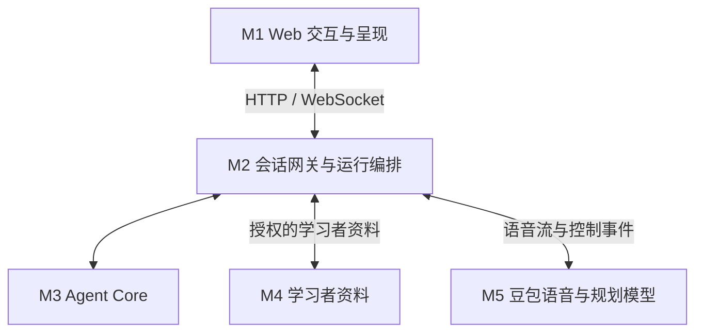
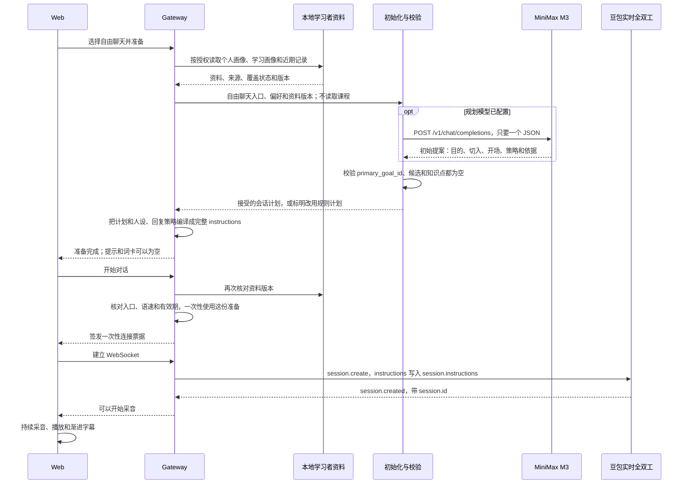
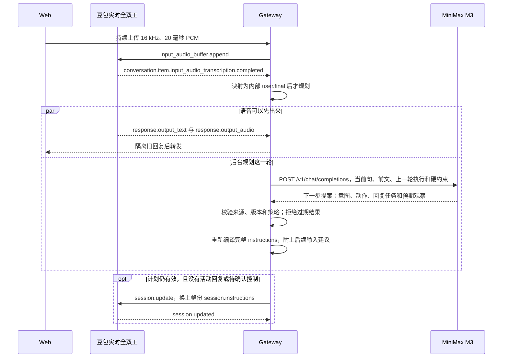

# Ask Kai 自由对话

教师主题作业已接入[中文输出标准与逐轮目标进展 GE-01～04](docs/teacher-goal-execution-implementation.md)：教师明确学生要用中文说什么，Kai 按实际表达调整下一步听说机会，练到本次要求后邀请继续或结束，仍由学生明确提交。会中判断异步限时，超时保持未确认；进展不等于掌握或评级，原 FreeTalk 不变。

主题作业新增[录音与音频评测核对链路](docs/conversation-report-audio-pipeline.md)：新会话自动保存录音，教师回听核对后交腾讯评测，结果与原音进入深入报告。原音不清或未确认来源时保持待核对；目前为本地 POC 人工核对路径，真实发音效果与自动声源识别尚未验收。

教师助教当前试用流程：开始主题对话时自动记录文本，提交后由 MiniMax 后台生成深入报告；分析完成前显示进度，双端不再显示基础反馈替代报告。文本无需逐次勾选，页面保留处理用途说明；分析服务未配置好时禁止开始，失败后可重试。腾讯发音真实验证仍待完成。详见[报告流程](docs/conversation-report-stage-c.md)。

主题报告的[阶段 C 工程实现](docs/conversation-report-stage-c.md)已接入后台 MiniMax 文本分析、分支状态 / 来源校验 / 复用重试与双端原文候选。769 项回归、合成浏览器及虚构文本的真实独立 Worker 链路通过；腾讯新版适配器已实现但真实发音 / 声源 / 对齐与专业验收未通过，C 与整体 feature 未完成。默认配置中采集和外传关闭；本地试用服务可单独开启文本采集和 AI 备课，报告外传需独立配置。[分层验证](docs/eval-results/2026-10-27-report-stage-c.md)。

主题报告的[技术架构已确认](docs/conversation-report-m4-architecture.md)：教学记录、分析任务与报告归 **M4 学习者资料模块**，由 M4 独立 Worker 在明确提交后离线分析；腾讯云智聆口语评测**新版**选型已确认，接入任务 **AUD-03-TX01** 的适配代码已实现，真实服务验证待完成。实时对话与提交回执不等待模型。

主题对话报告下一阶段的[文本、发音与深入分析任务清单 v1.2](docs/conversation-report-deep-analysis-tasking.md)已规划：记录授权的师生文本和必要学生音频，结合上下文模型与真实音频评测生成报告；**发音为 P0 / must-have，文本和发音均验收后才算 feature 完成**。已按 A～C 推进，整体未验收；旧会话缺失文本 / 音频不能还原。

报告分析首个切片已在 `codex/report-analysis` 实现：双端报告新增情境问答观察、表达信息 / 组织、求助策略和最多两项具体练习建议；教师可核对来源。点餐问答与部分跨主题组织形式使用有限规则，通用语义与真实听力 / 发音 / 语流仍独立验证。见[任务细化与实现边界](docs/teacher-assistant-report-analysis-tasking.md)、[本轮验收](docs/eval-results/2026-10-27-report-analysis.md)。

教师端 AI 前置备课第一阶段已合并回主干：主题与课后要求 → AI 教学包 / 个人目标 → 教师编辑确认 → 发布执行。原 Demo 4330 同时提供 AI 备课与预置点餐任务；4331 保留独立开发试用。见[实施与配置](docs/teacher-assistant-ai-planning-implementation.md)、[分层验收](docs/eval-results/2026-10-26-teacher-ai-planning.md)。当前只参考获准 Mock 等级，近期学习证据 / 多人分层 / 教学质量仍后续验证。

教师助教最小 Demo 已有独立入口：`npm run poc:teacher` → [本机 4330](http://127.0.0.1:4330)。预置点餐作业的发布、主题对话、明确提交与双端反馈已连通；不改 FreeTalk 流程。648 项回归 / 新旧浏览器通过，真实豆包经新页面与测试麦克风闭环通过，真人听感待验。见[试用与实现边界](docs/teacher-assistant-demo-implementation.md)、[验收记录](docs/eval-results/2026-10-26-teacher-assistant-demo.md)。

学生从自己想说的事开始，和 Kai 用中文实时聊天。Kai 先接住当前意思，再按需要澄清、示范或轻轻练习。普通交流可以没有教学目标；计划或关键词命中不能证明学生已经掌握。

这是从 Ask Kai 分出的自由对话仓库。页面只有这一个入口。身份、偏好和学习记录使用本地模拟数据；语音使用已配置的豆包实时全双工。它是本机试验，不是已上线的课程服务。

教师助教方向已整理独立的[需求分析](docs/teacher-assistant-requirements-analysis.md)、[师生 User Journey](docs/teacher-homework-user-journey.md)、[PRD v0.2](docs/prd/teacher-assigned-conversation-homework-prd-v0.2.md)及[前置规划与原仓库核对](docs/teacher-homework-planning-design.md)。方案为教师定主题、AI 提前准备资源和按人作业计划，在独立新场景开展主题对话并生成双端反馈；最小 Demo 与 AI 备课首个子集已实施，其他能力仍按 tasking 完善；现有 FreeTalk 的入口、规划与行为保持现状，A/B/C/D 仅供教师查看。

对应的[技术方案 v0.2](docs/teacher-assistant-technical-design.md)与[实施计划 / tasking](docs/teacher-assistant-tasking.md)已交付。当前优先 **G0 → [最小 Demo / MD-01～MD-08](docs/teacher-assistant-minimal-demo-tasking.md)**：一位教师、一位学生、预置点餐计划，打通发布 / 对话 / 提交 / 双端事实反馈；完整架构保留，之后完善教师 / 学生 / Kai 能力。当前完成范围见上述最小 Demo 与 AI 备课实施记录；完整 TA backlog 未整体完成，FreeTalk 保持现状，自动评级独立验收。

[背景](#1-背景说明) · [内容](#2-内容模块) · [架构](#3-架构设计) · [使用](#4-使用方式自由聊天) · [规划与小结](#5-动态规划语言支架与学习小结) · [评测](#6-评测机制与现有结果) · [启动](#7-启动) · [观测](#8-planner-与语音模型观测)

## 1. 背景说明

Ask Kai 希望学生在真实交流里学中文，而不是先完成一套固定课文。自由对话把学生当下的话题放在前面：可以讲生活、问一个词，也可以从一个短句开始。Kai 可以换着聊、接受拒绝、被打断或结束；学生没有要求练习时，不把旧兴趣或历史记录变成必做任务。

一次完整交流的闭环是：开聊前根据已授权资料形成初始计划，每一轮再根据学生实际说了什么规划下一步，然后说话、观察，并在结束时给出有来源的小结。模型负责理解意图和提出计划；程序负责权限、时间上限、校验和取消。反馈可以调整这一轮和后续计划，不会自动改写生产提示词，也不会把尝试写成掌握。

当前语音保持全双工。初始计划会在连接前写进语音指令；每一轮的新计划在安全的回复边界更新后续输入。现在还不能证明每一句语音都先规划再生成。

## 2. 内容模块

这些是学生和这次对话会碰到的内容，不是下面的工程分层。

| 模块 | 学生看到什么 | 现在怎么用 |
| --- | --- | --- |
| 自由聊天 | 提出自己的话题，Kai 先回应 | 初始没有教学目标，词卡和提示可以为空 |
| 学习者资料 | 可切换四位虚构学习者，并查看三类资料 | 个人画像、学习画像、最近最多 10 条记录；模拟掌握是作者设定的背景，不是本轮成果 |
| 偏好 | 兴趣、纠错、语言支架、理解情况和已知表达 | 已授权偏好进入计划和回复；更正后旧准备失效 |
| 语言支架 | 先听到中文，需要时紧接着短英文 | 按理解能力和当场请求变化，不给每句固定翻译 |
| 初始计划 | 开聊前看到这次怎么聊 | 读取三类资料后形成；普通聊天目标为空 |
| 逐轮计划 | 对话中 Kai 的下一步跟随刚说的话 | 每一轮重新规划；局部求助只影响当前轮，明确要求持续练习才选择通用技能 |
| 学习小结 | 结束后看实际聊过和练过的内容 | 只记录有来源的内容；没有练习时可以显示以交流为主 |

四位模拟学习者是 Alex／HSK1、Maya／HSK3、Leo／HSK5、Nina／HSK7。他们用来观察不同背景会不会得到不同的交流支持，不代表完整的 HSK 教学能力，也不是儿童上线验收。

## 3. 架构设计

### 3.1 Agent 核心能力

下面七项是职责，不是七个独立服务。一个工程模块可以承担多项。

| 核心能力 | 在自由对话里回答的问题 | 主要落点 |
| --- | --- | --- |
| 目标与约束 | 这次想达到什么？学生的选择、教学规则和权限允许做什么？ | Agent 核心；网关里的权限和运行约束 |
| 感知 | 学生说了什么、想表达什么？有没有打断或拒绝？上一句实际发生了什么？ | 豆包事件适配、网关的话轮归属、意图理解 |
| 记忆 | 兴趣、学习证据和近期记录是什么？这场对话正在做什么？ | 三类学习者资料；会话里的工作状态 |
| 规划 | 开聊时整体怎么聊？根据刚才的话，下一步怎么接？ | 初始计划与逐轮计划，使用 MiniMax M3 |
| 决策 | 哪个行动适合当前学生？提案是否有效、允许，并且还适用？ | 计划校验；网关接受并归属到这一轮 |
| 行动 | 怎样回复、示范、澄清，以及怎样保存获准的记录？ | 教学动作、网关编排、豆包语音、页面呈现 |
| 反馈与适应 | 实际效果和计划差多少？要不要减少支架、暂停或只聊天？ | 观察与证据；播放和执行回执；后续记录 |

### 3.2 五个核心工程模块

M2 和 M3 在同一个网关进程里。M1 由它的静态页面提供。M4 的本地模拟服务由 `npm run poc` 一并拉起。模块边界不等于分开部署。



| 模块 | 负责什么 | 自由对话里的现状 |
| --- | --- | --- |
| **M1 Web** | 采音、播放、渐进字幕、连接和异常状态、小结 | 只有自由聊天入口；准备完成不等于语音已连接 |
| **M2 网关** | 授权、一次性票据、话轮和回复归属、打断、超时、迟到结果隔离 | 准备会核对同一位学生、资料版本和有效期；旧计划不能覆盖新输入 |
| **M3 Agent 核心** | 人设、语言支架、初始计划、逐轮计划、校验、教学状态和小结 | 初始目标为空；明确持续练习才使用通用技能目录 |
| **M4 学习者资料** | 身份、三类资料、偏好、自愿保存的尝试 | 本地模拟，按学习者和会话隔离；只存在进程内存，重启重置 |
| **M5 语音与规划模型** | 豆包全双工；MiniMax M3 提出计划 | 语音是实时全双工；规划失败时改用规则计划，并在页面标明 |

### 3.2.1 主题教学记录与 M4 离线分析（设计已确认，阶段 A 基础已实施）

M4 的目标职责新增本次主题对话教学记录：完整可用文本、必要学生音频、来源与覆盖、提交 / 分析任务及报告。M4 数据服务负责权威存储与授权，独立 M4 分析 Worker 在明确提交后并行调用 M5 的 MiniMax 文本分析和腾讯智聆新版发音评测，校验汇总后存回 M4；M1 经授权接口查询。此处是新 feature 的架构，FreeTalk 的现有内存资料 / 默认行为仍按上表；当前已用独立 Worker 执行基础规则报告及显式开启的文本分析；腾讯仅完成适配器，真实调用及声学准入尚未通过。详见[架构与现状核对](docs/conversation-report-m4-architecture.md)、[实施任务](docs/conversation-report-deep-analysis-tasking.md)。

阶段 A 的本地记录契约和授权策略已实施。阶段 B 工作区正在接入授权文本记录和独立旧规则报告进程，文本和音频实验采集默认关闭；合成浏览器已验证基本流程，声源归属、实际对齐和腾讯真实评测仍待验收。见[阶段 A 实施与边界](docs/conversation-report-stage-a.md)和[阶段 B 进度](docs/conversation-report-stage-b-progress.md)。

### 3.3 支撑与治理

程序另外守住这些边界：状态版本、谁可以读资料、规划时间上限、回复归属、取消和幂等。课程知识与学生记录分开；自由对话不读取课程或主题包。资料要带来源、版本和覆盖状态，缺失不能被当成“不会”。

本地模拟的学习记录保存回执只说明本机内存写成功。它不代表真实账号、监护同意，或已经由真人处理。安全规则高于聊天风格。不保存原始音频；开发用的会话观测总结另在本机保留每场前 5 轮识别文本、回复文字和指令，范围见[观测说明](#8-planner-与语音模型观测)。

## 4. 使用方式：自由聊天

学生可以先提问、讲生活，或从一个词开始。Kai 尊重当前话题。需要时澄清或帮助表达，不把对话拉回某门固定课。

| 阶段 | 学生体验 | 当前行为 |
| --- | --- | --- |
| 进入 | 选择学习者，看到这次准备好的交流方式 | 读取三类资料和已授权偏好；初始目标为空 |
| 交流 | 分享或追问，Kai 先回应意思 | 普通交流允许零个知识点；求助可以给一处支持 |
| 调整 | 换话题、拒绝练习、打断或结束 | 当前说法优先于旧偏好和上一轮教学建议 |
| 小结 | 结束前听到有来源的小结，关闭后在页面看到同一份 | 列出这轮出现过的知识点、词汇和表达；没有可核验内容时说明以交流为主 |

持续采音、随时打断、慢速或正常语速、中文优先和按需短英文，都在这一条入口里。只有语音服务真实就绪后才申请麦克风，并显示连接成功。

会话中可以口头说“慢一点”“快一点”或“恢复正常”。Kai 先确认请求，播完后更新本场语速，配置确认成功后再用新语速说明结果；只影响当前会话。连续请求、打断和退出会隔离过期确认。分享与跨项目复用见[功能总结与移植说明](docs/spoken-speech-pace-feature-summary.md)、[独立 PRD](docs/prd/spoken-speech-pace-prd-v1.md)；工程追溯见[任务及结果](docs/spoken-speech-pace-tasking.md)。

拼音字幕首版已接入普通页面：Kai 中文字幕默认带声调拼音，注音不进入语音；可使用“显示拼音”开关，或在本场口头说“关闭拼音”“重新打开拼音”。新会话恢复默认，开聊前有明确标注的效果示例。636 项回归、普通 Web 的 8 项拼音＋12 项既有场景、真实豆包普通网关三轮开关通过；浏览器使用合成语音／Planner，真实网关使用模拟页面／播放回执，真人听感仍待验。多音字与混合任务有首版边界，见[PRD](docs/prd/pinyin-captions-prd-v1.md)、[实施与试用说明](docs/pinyin-captions-implementation.md)及[历史 spike](docs/pinyin-captions-spike.md)。

「对话内控制 Slides」已接入普通 Provider／Gateway／Web，**默认关闭，整体质量验收尚未通过**。只回看当前或更早且已展示的页，后续页自然暂缓；组件确认后才返回执行结果。已通过 624 项回归、三个 synthetic replay、普通 Web 的 12 项 CUA 自动化（合成语音／Planner、真实组件／播放），以及真实豆包经普通网关的基础三轮和两种插话补验；真人麦克风、听感与真实 Planner 竞争矩阵待验。开启使用 `ASK_KAI_SLIDES_CONTROL=true npm run poc`；新会话从第 1 页开始，尚无回看历史。仅本地 Mock 演示可另设 `ASK_KAI_SLIDES_DEMO_HISTORY=true`，由作者流程依次展示三页并收回执，页面明确标注测试历史，不代表已经学习。展示框不可用时降级普通聊天。实现与验证边界见[第六阶段报告](docs/eval-results/2026-10-26-voice-slides-control-stage6.md)、[实施清单](docs/voice-slides-control-tasking.md)、[PRD](docs/prd/voice-slides-control-prd-v1.md)和[技术方案](docs/voice-slides-control-design.md)。

### 4.1 进入对话



自由聊天的初始模型提案只包含 `conversation_purpose`、`content_focus`、最多两条 `opening_options`、`strategy` 和 `selection_basis`。初始请求不提供技能目录或候选目标；模型不输出 `primary_goal_id`、`candidate_goal_ids`、`key_points`，即使为空也不输出。完整 JSON、Draft、Pi 各自在宿主编译后补齐 `null / [] / []`，继续供下游使用；模型额外输出目标字段会被拒绝并在原预算内修复，不默默删掉目标。`strategy` 保留说话难度，语言支架、纠错和语速必须等于授权值／页面选择。页面分别显示未配置、超时、校验失败和服务不可用。[修复与验证记录](docs/eval-results/2026-10-18-free-initial-plan.md)。

宿主再补上计划编号、哈希和来源。`primary_goal` 仍为空，`goal_status` 是 `unverified`。这些字段留在 Ask Kai，不会作为豆包的顶层参数。豆包没有单独的设置教学目标接口。当前适配器把编译后的整段文字放进 `session.create` 的 `session.instructions`，同时带上配置里的模型 `1.2.6.1` 和音频格式。`session.created` 里的 `session.id` 通过适配器核验后，才变成内部就绪。下面是宿主补齐后的内部形状示意，不是模型原始返回，也不是某次真实返回：

```json
{
  "conversation_purpose": "跟随学生选择进行自然交流",
  "content_focus": "由学生选择话题",
  "opening_options": [],
  "primary_goal_id": null,
  "candidate_goal_ids": [],
  "key_points": [],
  "strategy": {
    "language_support": "auto",
    "support_level": "unknown",
    "correction": "gentle",
    "pace": "slow"
  },
  "selection_basis": [{ "reason": "free_student_choice", "refs": ["snapshot-id"] }]
}
```

准备好了还不等于已经连上语音。学生取消、更换学习者或更正偏好，会使正在进行的准备作废。

### 4.2 每一轮



每一轮不按动作调用不同的豆包接口。学生音频走 `input_audio_buffer.append`。转写完成事件带 `text`；旧夹具带 `transcript`，两者冲突就失败。适配器把它映射成内部 `user.final`，接受之后才用同一种 MiniMax JSON 接口做下一步规划。语音回复可以同时从 `response.output_text` 和 `response.output_audio` 出来，不等规划结束。

合格提案包含 `interpretation`、`prior_outcome`、`goal_assessment`、一个 `action`、`active_goal_id`、`local_help_target`、`reply_directive`、`expected_observation`、`proposed_plan_patch`、`evidence_refs` 和 `rationale_code`。`reply_directive` 只有任务、支架程度、0 或 1 个新点和预算引用。`expected_observation.required_student_answer` 必须是 `null`。明确结束可以由规则直接给出 `CLOSE`，不必等模型。

接受后，这些字段只作为文末的“后续输入建议”写进重新编译的整段指令。当前适配器在没有活动回复、也没有待确认的取消或上下文更新时，发送 `session.update`：供应商会话 `id` 加上这份完整 `instructions`。`session.updated` 只确认这一版上下文。它不能证明已经开口的那一句用了新计划，豆包也不会回“已执行某个动作”的业务回执。新的一句话、偏好更正、打断或退出，都会让旧计划失效。字段如何进入指令，见 [规划到豆包的链路](docs/planning-to-doubao-chain.md)。初始化与逐轮 Planner 的职责、四位 Mock 学习者对照、降级和个性化缺口，见[自由对话 Planner 机制](docs/free-conversation-planner-summary.md)。

## 5. 动态规划、语言支架与学习小结

### 5.1 初始化与逐轮计划

开聊前和每一轮都有计划，但它们的时间上限不同。

| 计划 | 什么时候做 | 时间上限 | 看哪些材料 |
| --- | --- | --- | --- |
| 初始化 | 连接语音之前 | 15 秒，含读取资料、模型请求、最多一次修复和校验；预留 50 毫秒提交 | 三类已授权资料、当前偏好、通用技能目录 |
| 逐轮 | 接受一段有效学生表达之后 | 2 秒，从接受时刻起算；预留 200 毫秒提交 | 当前这句话、最近有限的实际前文、上一轮执行情况、语言和拒绝状态 |

初始计划必须是没有正式目标、没有候选目标、没有知识点。学生只是求助一个说法时，帮助留在当前轮。学生明确说想持续练习时，才从通用技能目录里选择一项，并检查先修；对话模式仍是自由聊天，不改去读课程。

模型提案要经过字段、长度、来源引用和策略校验。没有配置模型、服务不可用、返回内容不合格，或时间用完，都会改用规则计划，并单独记下原因。规则计划先回应学生刚说的内容，不借此新增目标。页面上的“规划模型暂不可用”表示这次没有采用模型提案，具体原因可能是超时、格式不合格或服务不可用。

默认模式是 `next_turn_advisory`。`controlled` 尚未验证本轮先规划再生成，因此保持关闭，不会发起那种连接。

### 5.2 按资料和偏好回复

准备和每一轮规划都会读取已经授权的资料：

- 个人画像里的兴趣、语速和纠错偏好，用来决定聊什么切入、说多快、怎样纠正。
- 学习画像里的理解情况、语言支架和已知表达，用来决定中文难度和是否需要英文。
- 近期记录里的拒绝、求助和练习痕迹，用来避免恢复学生已经拒绝的练习。

这些资料是背景，不是学生这一句的意思。当前明确说出的话题、拒绝和语言要求优先于旧偏好。在页面上更正偏好后，旧准备失效，活动会话会刷新最小的学生上下文。兴趣可以帮助选择交流内容，不能被当成已经掌握某项能力。

### 5.3 语言支架

始终先说中文。英文是帮助理解的支架，不是每句都要配上的译文。

- 初学者或理解情况未知时，可以用一句短英文解释刚才的中文。
- 学生表示能听懂，或当前是已知表达时，熟悉的话可以只有中文。
- 新表达、求助或说没听懂时，恢复短英文；学生明确只要中文时，确认语本身也只用中文。
- “这一句”的要求只影响这一次回复；“接下来”影响本场会话；只有在页面上保存，才改变以后会话的画像。
- 必要的英文紧跟它所解释的中文，不另加知识点或第二个问题。

回复长短随这一轮的意图、理解需要和偏好变化，不设固定字数或句数。每一轮有一个交流重心，最多邀请学生回答一个主要问题。普通聊天可以没有新知识点；主动教学仍只聚焦一个新点和一个短示范。

### 5.4 学习小结与保存

结束时先给出有来源的小结，再关闭。小结可以说明实际聊到的话题、发生过的练习和未知的部分。没有练习时，可以诚实显示这一轮以交流为主。取消、没播完或未评估的内容，不会变成已学成果。

学生明确结束后，系统进入收尾：停止普通逐轮规划，预览本次有来源的小结，让 Kai 简要回顾实际聊到的内容并告别。口头收尾期间继续采音，学生说“等等，我还想问……”会撤销旧收尾；点击结束按钮或明确说“马上结束，不用总结”则立即退出。

模型输出完成与浏览器播放完成分开处理。只有本次收尾编号、回复编号、小结版本和音频时长都匹配，且浏览器报告音频排空和字幕展示完成，才正常关闭并释放麦克风。上一轮回复、重复或迟到回执不能结束新会话。等待回复、播报和播放都有超时；超时会保留文字小结并标记语音小结未完成，不把它算成已播完。

结束时自动把交流目的、实际涉及的词汇／表达及来源写入授权的本地 Mock 会话记录，页面可查询服务端保存状态。内容记录与正式学习尝试分开；提到、示范和播放回执都不升级为掌握。保存失败或未确认会如实显示。记录仅在当前进程内存中，重启清空。

保留本仓库已有的豆包退出识别：`session.create` 带 `extension.dialog.extra.enable_user_query_exit: true`；既有有界真实观察中，`response.output_audio.done` 可带 `status_code: "20000002"`。退出信号或已转发的明确告别只绑定已接受且归属有效的回复，然后等待同一套播放确认，不再取消已完成的告别、要求模型另说一遍。词义问题、否定、旧话轮和外来回复不能凭退出信号关闭。采集诊断会话保留脚本模式，不自动收尾。

口头内容仍走 `next_turn_advisory`，没有启用本轮生成门控；上下文 ACK 和播放回执不证明豆包逐字遵循小结，更不证明学生听懂。机制见[收尾设计与原仓库记录](docs/conversation-closing-design.md)，本仓库适配范围和分层验证见[增强移植分析](docs/freetalk-enhancement-port.md)。

## 6. 评测机制与现有结果

工程通过、内容评分、真实语音和设备听感分开判断。一项通过不能代替另一项。

| 层级 | 检查什么 | 边界 |
| --- | --- | --- |
| 工程与契约 | 权限、话轮归属、取消、资料版本、自由对话不读取课程 | 自动化测试和合成回放；不等于教学合格 |
| 对话内容 | 意图、语言顺序、是否遵循当前选择、小结是否有来源 | 固定自由对话脚本；模型辅助审阅不是人工验收 |
| 实时体验 | 首句、停顿、打断、字幕和小结是否顺耳 | 需要真实豆包和设备；不能从文字分数推断 |
| 动态规划 | 初始计划是否为空、逐轮计划是否在时限内、失败是否标明 | 规则计划成功不算模型已经做出自适应决定 |

已有的自由对话内容结果来自固定脚本和录音，评分是模型辅助的离线审阅，没有人工批准，也没有独立 Judge 接口调用。

| 记录 | 范围 | 结果 | 怎么理解 |
| --- | --- | --- | --- |
| 2026-10-12 自由对话基线 | 40 个原始案例加 8 个语言对照；47/48 案完整，244/255 轮已评分 | 120 通过／88 待复核／36 失败；加权均分 94.15 | 质量验收未完成。见 [基线报告](docs/eval-results/2026-10-12-freechat-baseline.md) |
| 2026-10-13 针对性回归 | 26 案／149 轮中的 24 案完整、145 轮已评分 | 103 通过／29 待复核／13 失败 | 仍未整体验收。可比 134 轮均分由 94.60 到 96.44。见 [对比报告](docs/eval-results/2026-10-13-harness-formal-comparison.md) |

这两次采集范围不同，不能直接比较总通过率。它们说明固定自由对话脚本上还有语言对应、结束收束和本轮策略时序问题，不证明当前这份代码已经通过教学质量或设备验收。

还没有完成的包括：规划模型在 15 秒和 2 秒里的真实完成率、每一轮语音是否遵循计划、播放范围回执，以及真人听感。清单见 [自由对话链路审查](docs/free-conversation-engineering-review.md)。

## 7. 启动

需要 Node ≥ 22.19。依赖安装和本机语音配置分开做。密钥和审核后的语音配置只留在本机，不要提交。

```bash
npm ci --ignore-scripts
cp .env.example .env
mkdir -p .local
cp docs/protocol/seeduplex-profile.template.json .local/seeduplex-profile.json
```

`.env` 和 `.local/` 都在 `.gitignore` 里。`.local` 以点开头，文件列表里默认看不见；用路径 `.local/seeduplex-profile.json` 直接打开。

在 `.env` 写入本机密钥，并把语音提供方改成豆包：

```dotenv
ASK_KAI_BACKEND=mock
ASK_KAI_PROVIDER=doubao
ASK_KAI_PLANNING_MODE=next_turn_advisory
ASK_KAI_PLANNER_PROVIDER=minimax
ASK_KAI_PLANNER_PROTOCOL=full_contract_v3
DOUBAO_API_KEY=你的本地密钥
DOUBAO_REALTIME_PROFILE=./.local/seeduplex-profile.json
MINIMAX_API_KEY=你的本地规划模型密钥
MINIMAX_BASE_URL=https://api.minimax.cn/v1
MINIMAX_PLANNER_MODEL=MiniMax-M3
```

仓库里的 `docs/protocol/seeduplex-profile.template.json` 三个审核开关保持 `false`，不能直接拿来启动网页语音。只在本机副本 `.local/seeduplex-profile.json` 上，审核完成后把这三项改成 `true`：

- `reviewed`
- `realtime.reviewed`
- `realtime.ordered_acks_reviewed`

密钥只放在 `.env` 的 `DOUBAO_API_KEY` 和 `MINIMAX_API_KEY`，不要写进 JSON，也不要贴到对话里。`docs/protocol/seeduplex-connect.profile.json` 只覆盖静态连接探针，实时开关仍是 `false`，同样不能当作网页语音配置。审核范围见 [Seeduplex 接入说明](docs/protocol/seeduplex-integration.md)。这三个布尔值是本机操作记录。进程接受配置，不等于这一次会话已经连上豆包，也不等于设备听感通过。

```bash
npm run poc
```

打开 http://127.0.0.1:4310 。启动日志出现 `reviewed voice configured; readiness per session` 时，说明这份本地配置通过了静态校验。页面上的准备完成还不等于语音已连接；只有这一次会话收到豆包就绪之后，才会申请麦克风。

调试 Planner 和语音指令时，可打开 [观测页面](http://127.0.0.1:4310/?observe=1)，使用方法见下方[观测说明](#8-planner-与语音模型观测)。

没有密钥，或本地配置仍有审核开关为 `false` 时，豆包模式会拒绝启动。把 `ASK_KAI_PROVIDER` 留在 `replay` 可以打开页面查看学习者和偏好；那是合成预览，不会连接豆包。

工程检查：

```bash
npm run verify
npm run replay
```

`npm run verify` 检查运行契约，`npm run replay` 跑合成回放。二者都不代替真实模型和浏览器听感。

## 8. Planner 与语音模型观测

普通页面自动整理每场对话前 5 轮，结束或中断后可一键汇总导出。需要进一步排查时，可打开详细时间线，核对初始／逐轮规划、难度要求、实际发送给豆包的配置和回复。

### 8.1 对话后，一键汇总导出

直接使用 [普通页面](http://127.0.0.1:4310/)，无需开启调试参数。

1. 选择学习者，开始一场对话。
2. 结束或中断后，在「会话观测总结」中查看本场记录。未保存成功会提示刷新，不会自动选上一场冒充本场。
3. 点击「汇总并导出观测总结」，下载已整理的 Markdown 文件，不需要自己从事件 JSON 中拼接内容。也可从列表选择历史会话。

每条回复自动关联豆包 Log ID（如已取得）、供应商 session／response ID、当时的指令版本与完整 instructions、实际 response、Planner 的预期任务／语言难度／观察要求，以及打断和错误信息。「预期 response」「预期效果」「观察备注」可选填写，导出时一并保存；不填写也可导出。没有标准答案的自由对话会保留 Planner 要求，不编造一段“正确回复”。模型是否真正采用计划、词汇是否达标及真人听感，未验证时明确标为未知／未评估。

“前 5 轮”指服务接受的前 5 次学生完整表达及其归属回复；不足 5 轮也能导出。开场等尚未关联到学生输入的回复单列，最多 2 条；后续学生轮次不进入总结。中断回复会标注未完整结束，保留已转发的文字。

本机 POC 将总结存到被 Git 忽略的 `.local/observation-reports/`，按授权账号和学习者隔离，每位学习者最多保留最近 20 场，每场最多 1 MiB，刷新和服务重启后仍可查看。**20 场是历史容量；每场仍只整理前 5 轮。** 这些是开发观测记录，与仅保存在内存的学习小结分开，不作为学习成果。不含原始音频、密钥或原始供应商消息，不要提交含真实对话的文件。

豆包 Log ID 仅采集 WebSocket 握手返回的 `x-tt-logid`，属于这次连接，不给每轮伪造新 ID。服务未返回时明确写“未取得”，不会用本地会话编号代替。2026-10-19 无音频的真实连接检查已收到该值和供应商 session ID；这不代表真实对话回复或真人听感已验收。

### 8.2 详细事件时间线

启动服务后，打开 [http://127.0.0.1:4310/?observe=1](http://127.0.0.1:4310/?observe=1)，展开页面下方「Planner 与语音模型观测」。普通页面也有开启链接，点击后会重新加载。

1. 选择学习者，等待准备完成，查看初始规划。
2. 开始新对话，查看每轮学生表达、规划和语音交互。
3. 展开事件查看 JSON；通过「查看范围」筛选初始规划、逐轮规划、学生输入或语音模型交互。
4. 需要分析时，点击「导出观测 JSON（含文本）」保存当前保留的事件。

详细时间线默认不展示；前 5 轮总结在普通页面自动采集，只能整理更新后新创建的会话，不能追溯以前的对话。每次重新准备使用独立的 `trace_id`；开始对话时沿用该准备的观测。每次规划用 `planning_id` 关联请求与结果，`attempt` 区分重试；逐轮事件用 `turn_id` 关联学生表达。

### 8.3 观测链路

| 环节 | 可以看到的内容 |
| --- | --- |
| 触发 Planner | 初始／逐轮类型、授权输入、模型信息、时间预算和尝试序号 |
| 请求规划模型 | 实际请求地址、方法和 JSON body，包括 messages、生成参数，以及 Pi 使用的工具定义 |
| 返回与校验 | 模型 content 或 tool_calls、HTTP 状态、结束原因、token 用量、编译后的提案及校验错误码 |
| 修复与采用 | 重试原因、规则降级原因、最终采用的计划，以及过期或取消的结果 |
| 更新语音模型 | 完整 instructions、实际发送的 session.create／session.update／response.cancel body、配置版本与哈希、等待更新的原因和确认事件 |
| 打断与超时 | 自动识别或手动触发的来源、旧话轮与回复、实际取消请求、确认、跳过或超时时长 |
| 开始与转发回复 | 回复开始时已确认的配置版本、是否仍有配置待确认，以及通过安全和归属检查后转发的回复文字 |

例如排查 Alex 的中文是否过难，先看初始计划的 `strategy.speaking_difficulty` 和 `speaking_constraints`，再展开 `voice.request.sent`，在 `body.session.instructions` 中查找「说话要求」，确认普通主动用词范围为 HSK1。逐轮调整还要查看校验／降级、指令发送与确认，再对照 `voice.reply.started` 的配置版本和哈希。

当前全双工允许语音先生成、Planner 在后台规划。**配置确认只证明更新已确认；回复开始事件记录的是当时已确认的配置，不能证明此前生成的语音使用了最新计划或遵守了难度要求。** 已转发回复文字也不代表浏览器已经播放完毕。

总结会固定每条回复开始时所关联配置中的预期，另列对该输入产生的后续 Planner 提案，避免把晚到的计划当成本轮已经执行的要求。指令逐版标注是否实际发送、是否确认；没有发送证据的编译快照不会冒充实际请求。

### 8.4 详细事件的保留范围

原始事件时间线只临时保留在本机服务内存和当前页面，不自动写磁盘。它与上面的持久化总结分开。页面刷新、重新准备或切换学习者会清除旧的时间线显示；「清空显示」只清除时间线，不删除会话总结。回到不带 `observe=1` 的页面后会隐藏详细面板，仍自动整理每场前 5 轮。

服务端与页面分别最多保留 160 条、2 MiB；服务端单条观测上限为 128 KiB。超大事件会标记省略，容量超限会淘汰旧事件，发送受背压限制；页面会提示已清理或未送达的事件。导出只包含当前保留的内容，不保证长会话完整。

请求和返回可能包含学习者画像、提示词及对话文字，手动导出也包含这些文字，不要提交到仓库。观测不采集鉴权头、Cookie、连接票据、原始音频或模型思考过程。

`?observe=1` 不改变自动收尾。原有 `?diagnostics=1` 是独立的元数据体验采集开关，会抑制自动收束；普通链路排查使用 `?observe=1` 即可。详细事件、关联字段及验证边界见 [Planner 观测说明](docs/planner-observation.md)。

2026-10-28 作业录音自动核验本地链路：M4 持久异步识别、测量预检、发音候选评测与受限报告已接通，教师无需逐段确认。腾讯 ASR 真实联调、真人音频校准另验；详见 [实施说明](docs/audio-auto-verification-implementation.md)。
