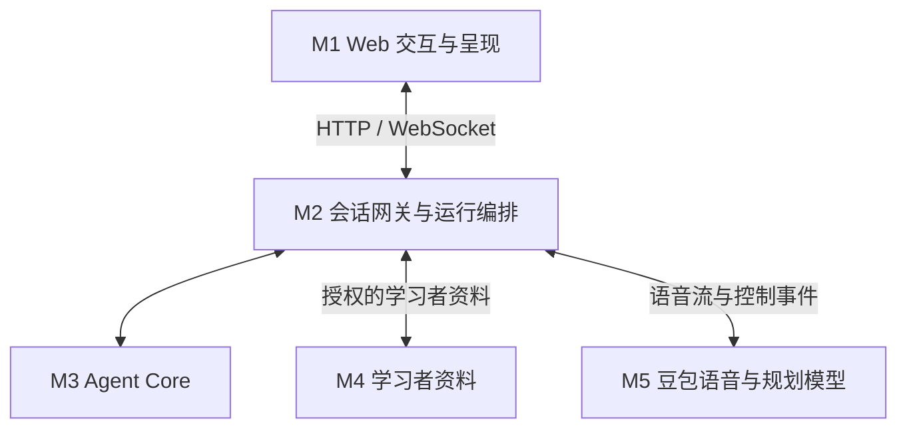
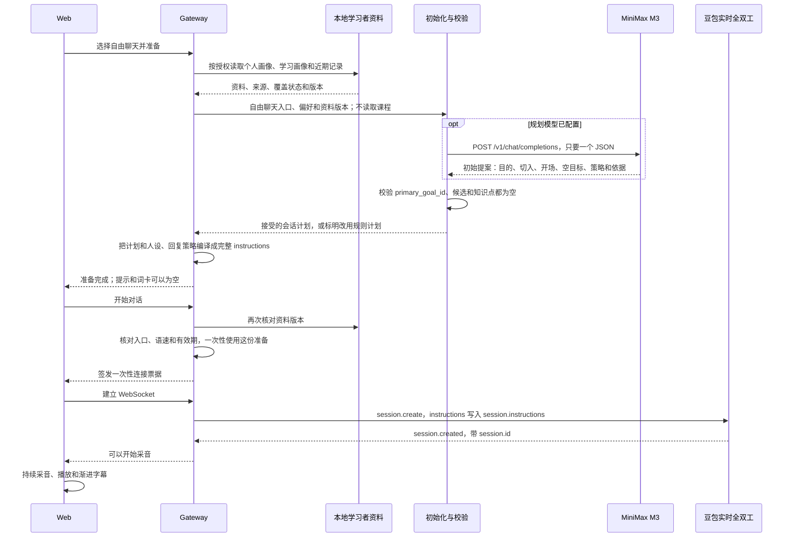
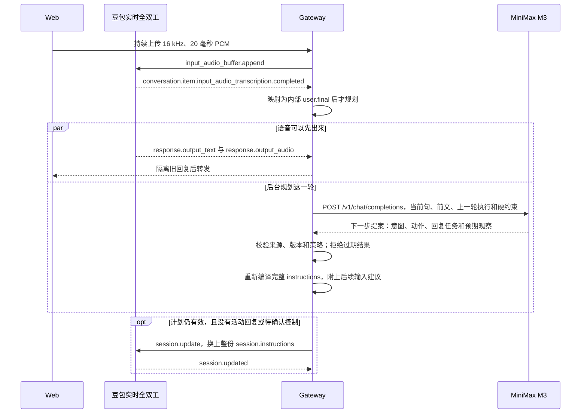

# Ask Kai 自由对话

学生从自己想说的事开始，和 Kai 用中文实时聊天。Kai 先接住当前意思，再按需要澄清、示范或轻轻练习。普通交流可以没有教学目标；计划或关键词命中不能证明学生已经掌握。

这是从 Ask Kai 分出的自由对话仓库。页面只有这一个入口。身份、偏好和学习记录使用本地模拟数据；语音使用已配置的豆包实时全双工。它是本机试验，不是已上线的课程服务。

[背景](#1-背景说明) · [内容](#2-内容模块) · [架构](#3-架构设计) · [使用](#4-使用方式自由聊天) · [规划与小结](#5-动态规划语言支架与学习小结) · [评测](#6-评测机制与现有结果) · [启动](#7-启动)

## 1. 背景说明

Ask Kai 希望学生在真实交流里学中文，而不是先完成一套固定课文。自由对话把学生当下的话题放在前面：可以讲生活、问一个词，也可以从一个短句开始。Kai 可以换着聊、接受拒绝、被打断或结束；学生没有要求练习时，不把旧兴趣或历史记录变成必做任务。

一次完整交流的闭环是：开聊前根据已授权资料形成初始计划，每一轮再根据学生实际说了什么规划下一步，然后说话、观察，并在结束时给出有来源的小结。模型负责理解意图和提出计划；程序负责权限、时间上限、校验和取消。反馈可以调整这一轮和后续计划，不会自动改写生产提示词，也不会把尝试写成掌握。

当前语音保持全双工。初始计划会在连接前写进语音指令；每一轮的新计划在安全的回复边界更新后续输入。现在还不能证明每一句语音都先规划再生成。

## 2. 内容模块

这些是学生和这次对话会碰到的内容，不是下面的工程分层。

| 模块 | 学生看到什么 | 现在怎么用 |
| --- | --- | --- |
| 自由聊天 | 提出自己的话题，Kai 先回应 | 初始没有教学目标，词卡和提示可以为空 |
| 学习者资料 | 可切换四位虚构学习者，并查看三类资料 | 个人画像、学习画像、最近最多 10 条记录；模拟掌握是作者设定的背景，不是本轮成果 |
| 偏好 | 兴趣、纠错、语言支架、理解情况和已知表达 | 已授权偏好进入计划和回复；更正后旧准备失效 |
| 语言支架 | 先听到中文，需要时紧接着短英文 | 按理解能力和当场请求变化，不给每句固定翻译 |
| 初始计划 | 开聊前看到这次怎么聊 | 读取三类资料后形成；普通聊天目标为空 |
| 逐轮计划 | 对话中 Kai 的下一步跟随刚说的话 | 每一轮重新规划；局部求助只影响当前轮，明确要求持续练习才选择通用技能 |
| 学习小结 | 结束后看实际聊过和练过的内容 | 只记录有来源的内容；没有练习时可以显示以交流为主 |

四位模拟学习者是 Alex／HSK1、Maya／HSK3、Leo／HSK5、Nina／HSK7。他们用来观察不同背景会不会得到不同的交流支持，不代表完整的 HSK 教学能力，也不是儿童上线验收。

## 3. 架构设计

### 3.1 Agent 核心能力

下面七项是职责，不是七个独立服务。一个工程模块可以承担多项。

| 核心能力 | 在自由对话里回答的问题 | 主要落点 |
| --- | --- | --- |
| 目标与约束 | 这次想达到什么？学生的选择、教学规则和权限允许做什么？ | Agent 核心；网关里的权限和运行约束 |
| 感知 | 学生说了什么、想表达什么？有没有打断或拒绝？上一句实际发生了什么？ | 豆包事件适配、网关的话轮归属、意图理解 |
| 记忆 | 兴趣、学习证据和近期记录是什么？这场对话正在做什么？ | 三类学习者资料；会话里的工作状态 |
| 规划 | 开聊时整体怎么聊？根据刚才的话，下一步怎么接？ | 初始计划与逐轮计划，使用 MiniMax M3 |
| 决策 | 哪个行动适合当前学生？提案是否有效、允许，并且还适用？ | 计划校验；网关接受并归属到这一轮 |
| 行动 | 怎样回复、示范、澄清，以及怎样保存获准的记录？ | 教学动作、网关编排、豆包语音、页面呈现 |
| 反馈与适应 | 实际效果和计划差多少？要不要减少支架、暂停或只聊天？ | 观察与证据；播放和执行回执；后续记录 |

### 3.2 五个核心工程模块

M2 和 M3 在同一个网关进程里。M1 由它的静态页面提供。M4 的本地模拟服务由 `npm run poc` 一并拉起。模块边界不等于分开部署。



| 模块 | 负责什么 | 自由对话里的现状 |
| --- | --- | --- |
| **M1 Web** | 采音、播放、渐进字幕、连接和异常状态、小结 | 只有自由聊天入口；准备完成不等于语音已连接 |
| **M2 网关** | 授权、一次性票据、话轮和回复归属、打断、超时、迟到结果隔离 | 准备会核对同一位学生、资料版本和有效期；旧计划不能覆盖新输入 |
| **M3 Agent 核心** | 人设、语言支架、初始计划、逐轮计划、校验、教学状态和小结 | 初始目标为空；明确持续练习才使用通用技能目录 |
| **M4 学习者资料** | 身份、三类资料、偏好、自愿保存的尝试 | 本地模拟，按学习者和会话隔离；只存在进程内存，重启重置 |
| **M5 语音与规划模型** | 豆包全双工；MiniMax M3 提出计划 | 语音是实时全双工；规划失败时改用规则计划，并在页面标明 |

### 3.3 支撑与治理

程序另外守住这些边界：状态版本、谁可以读资料、规划时间上限、回复归属、取消和幂等。课程知识与学生记录分开；自由对话不读取课程或主题包。资料要带来源、版本和覆盖状态，缺失不能被当成“不会”。

本地模拟的保存回执只说明本机内存写成功。它不代表真实账号、监护同意，或已经由真人处理。安全规则高于聊天风格。不保存原始音频和完整逐字稿。

## 4. 使用方式：自由聊天

学生可以先提问、讲生活，或从一个词开始。Kai 尊重当前话题。需要时澄清或帮助表达，不把对话拉回某门固定课。

| 阶段 | 学生体验 | 当前行为 |
| --- | --- | --- |
| 进入 | 选择学习者，看到这次准备好的交流方式 | 读取三类资料和已授权偏好；初始目标为空 |
| 交流 | 分享或追问，Kai 先回应意思 | 普通交流允许零个知识点；求助可以给一处支持 |
| 调整 | 换话题、拒绝练习、打断或结束 | 当前说法优先于旧偏好和上一轮教学建议 |
| 小结 | 结束前听到有来源的小结，关闭后在页面看到同一份 | 列出这轮出现过的知识点、词汇和表达；没有可核验内容时说明以交流为主 |

持续采音、随时打断、慢速或正常语速、中文优先和按需短英文，都在这一条入口里。只有语音服务真实就绪后才申请麦克风，并显示连接成功。

### 4.1 进入对话



自由聊天的初始化不返回教学目标。MiniMax 的 `POST /v1/chat/completions` 只要求正文是一个 JSON 对象。校验接受的提案只有这些字段：`conversation_purpose`、`content_focus`、最多两条 `opening_options`、`primary_goal_id: null`、空的 `candidate_goal_ids` 和 `key_points`、`strategy`，以及 `selection_basis`。`strategy` 里的语言支架、纠错和语速必须等于已授权偏好。目标或知识点只要非空就拒绝。未配置、超时或不合格时，规则计划仍是这个形状，页面会标明。

宿主再补上计划编号、哈希和来源。`primary_goal` 仍为空，`goal_status` 是 `unverified`。这些字段留在 Ask Kai，不会作为豆包的顶层参数。豆包没有单独的设置教学目标接口。当前适配器把编译后的整段文字放进 `session.create` 的 `session.instructions`，同时带上配置里的模型 `1.2.6.1` 和音频格式。`session.created` 里的 `session.id` 通过适配器核验后，才变成内部就绪。下面是契约形状，不是某次真实返回：

```json
{
  "conversation_purpose": "跟随学生选择进行自然交流",
  "content_focus": "由学生选择话题",
  "opening_options": [],
  "primary_goal_id": null,
  "candidate_goal_ids": [],
  "key_points": [],
  "strategy": {
    "language_support": "auto",
    "support_level": "unknown",
    "correction": "gentle",
    "pace": "slow"
  },
  "selection_basis": [{ "reason": "free_student_choice", "refs": ["snapshot-id"] }]
}
```

准备好了还不等于已经连上语音。学生取消、更换学习者或更正偏好，会使正在进行的准备作废。

### 4.2 每一轮



每一轮不按动作调用不同的豆包接口。学生音频走 `input_audio_buffer.append`。转写完成事件带 `text`；旧夹具带 `transcript`，两者冲突就失败。适配器把它映射成内部 `user.final`，接受之后才用同一种 MiniMax JSON 接口做下一步规划。语音回复可以同时从 `response.output_text` 和 `response.output_audio` 出来，不等规划结束。

合格提案包含 `interpretation`、`prior_outcome`、`goal_assessment`、一个 `action`、`active_goal_id`、`local_help_target`、`reply_directive`、`expected_observation`、`proposed_plan_patch`、`evidence_refs` 和 `rationale_code`。`reply_directive` 只有任务、支架程度、0 或 1 个新点和预算引用。`expected_observation.required_student_answer` 必须是 `null`。明确结束可以由规则直接给出 `CLOSE`，不必等模型。

接受后，这些字段只作为文末的“后续输入建议”写进重新编译的整段指令。当前适配器在没有活动回复、也没有待确认的取消或上下文更新时，发送 `session.update`：供应商会话 `id` 加上这份完整 `instructions`。`session.updated` 只确认这一版上下文。它不能证明已经开口的那一句用了新计划，豆包也不会回“已执行某个动作”的业务回执。新的一句话、偏好更正、打断或退出，都会让旧计划失效。字段如何进入指令，见 [规划到豆包的链路](docs/planning-to-doubao-chain.md)。初始化与逐轮 Planner 的职责、四位 Mock 学习者对照、降级和个性化缺口，见[自由对话 Planner 机制](docs/free-conversation-planner-summary.md)。

## 5. 动态规划、语言支架与学习小结

### 5.1 初始化与逐轮计划

开聊前和每一轮都有计划，但它们的时间上限不同。

| 计划 | 什么时候做 | 时间上限 | 看哪些材料 |
| --- | --- | --- | --- |
| 初始化 | 连接语音之前 | 15 秒，含读取资料、模型请求、最多一次修复和校验；预留 50 毫秒提交 | 三类已授权资料、当前偏好、通用技能目录 |
| 逐轮 | 接受一段有效学生表达之后 | 2 秒，从接受时刻起算；预留 200 毫秒提交 | 当前这句话、最近有限的实际前文、上一轮执行情况、语言和拒绝状态 |

初始计划必须是没有正式目标、没有候选目标、没有知识点。学生只是求助一个说法时，帮助留在当前轮。学生明确说想持续练习时，才从通用技能目录里选择一项，并检查先修；对话模式仍是自由聊天，不改去读课程。

模型提案要经过字段、长度、来源引用和策略校验。没有配置模型、服务不可用、返回内容不合格，或时间用完，都会改用规则计划，并单独记下原因。规则计划先回应学生刚说的内容，不借此新增目标。页面上的“规划模型暂不可用”表示这次没有采用模型提案，具体原因可能是超时、格式不合格或服务不可用。

默认模式是 `next_turn_advisory`。`controlled` 尚未验证本轮先规划再生成，因此保持关闭，不会发起那种连接。

### 5.2 按资料和偏好回复

准备和每一轮规划都会读取已经授权的资料：

- 个人画像里的兴趣、语速和纠错偏好，用来决定聊什么切入、说多快、怎样纠正。
- 学习画像里的理解情况、语言支架和已知表达，用来决定中文难度和是否需要英文。
- 近期记录里的拒绝、求助和练习痕迹，用来避免恢复学生已经拒绝的练习。

这些资料是背景，不是学生这一句的意思。当前明确说出的话题、拒绝和语言要求优先于旧偏好。在页面上更正偏好后，旧准备失效，活动会话会刷新最小的学生上下文。兴趣可以帮助选择交流内容，不能被当成已经掌握某项能力。

### 5.3 语言支架

始终先说中文。英文是帮助理解的支架，不是每句都要配上的译文。

- 初学者或理解情况未知时，可以用一句短英文解释刚才的中文。
- 学生表示能听懂，或当前是已知表达时，熟悉的话可以只有中文。
- 新表达、求助或说没听懂时，恢复短英文；学生明确只要中文时，确认语本身也只用中文。
- “这一句”的要求只影响这一次回复；“接下来”影响本场会话；只有在页面上保存，才改变以后会话的画像。
- 必要的英文紧跟它所解释的中文，不另加知识点或第二个问题。

回复长短随这一轮的意图、理解需要和偏好变化，不设固定字数或句数。每一轮有一个交流重心，最多邀请学生回答一个主要问题。普通聊天可以没有新知识点；主动教学仍只聚焦一个新点和一个短示范。

### 5.4 学习小结与保存

结束时先给出有来源的小结，再关闭。小结可以说明实际聊到的话题、发生过的练习和未知的部分。没有练习时，可以诚实显示这一轮以交流为主。取消、没播完或未评估的内容，不会变成已学成果。

学生明确结束后，系统进入收尾：停止普通逐轮规划，预览本次有来源的小结，让 Kai 简要回顾实际聊到的内容并告别。口头收尾期间继续采音，学生说“等等，我还想问……”会撤销旧收尾；点击结束按钮或明确说“马上结束，不用总结”则立即退出。

模型输出完成与浏览器播放完成分开处理。只有本次收尾编号、回复编号、小结版本和音频时长都匹配，且浏览器报告音频排空和字幕展示完成，才正常关闭并释放麦克风。上一轮回复、重复或迟到回执不能结束新会话。等待回复、播报和播放都有超时；超时会保留文字小结并标记语音小结未完成，不把它算成已播完。

结束时自动把交流目的、实际涉及的词汇／表达及来源写入授权的本地 Mock 会话记录，页面可查询服务端保存状态。内容记录与正式学习尝试分开；提到、示范和播放回执都不升级为掌握。保存失败或未确认会如实显示。记录仅在当前进程内存中，重启清空。

保留本仓库已有的豆包退出识别：`session.create` 带 `extension.dialog.extra.enable_user_query_exit: true`；既有有界真实观察中，`response.output_audio.done` 可带 `status_code: "20000002"`。退出信号或已转发的明确告别只绑定已接受且归属有效的回复，然后等待同一套播放确认，不再取消已完成的告别、要求模型另说一遍。词义问题、否定、旧话轮和外来回复不能凭退出信号关闭。采集诊断会话保留脚本模式，不自动收尾。

口头内容仍走 `next_turn_advisory`，没有启用本轮生成门控；上下文 ACK 和播放回执不证明豆包逐字遵循小结，更不证明学生听懂。机制见[收尾设计与原仓库记录](docs/conversation-closing-design.md)，本仓库适配范围和分层验证见[增强移植分析](docs/freetalk-enhancement-port.md)。

## 6. 评测机制与现有结果

工程通过、内容评分、真实语音和设备听感分开判断。一项通过不能代替另一项。

| 层级 | 检查什么 | 边界 |
| --- | --- | --- |
| 工程与契约 | 权限、话轮归属、取消、资料版本、自由对话不读取课程 | 自动化测试和合成回放；不等于教学合格 |
| 对话内容 | 意图、语言顺序、是否遵循当前选择、小结是否有来源 | 固定自由对话脚本；模型辅助审阅不是人工验收 |
| 实时体验 | 首句、停顿、打断、字幕和小结是否顺耳 | 需要真实豆包和设备；不能从文字分数推断 |
| 动态规划 | 初始计划是否为空、逐轮计划是否在时限内、失败是否标明 | 规则计划成功不算模型已经做出自适应决定 |

已有的自由对话内容结果来自固定脚本和录音，评分是模型辅助的离线审阅，没有人工批准，也没有独立 Judge 接口调用。

| 记录 | 范围 | 结果 | 怎么理解 |
| --- | --- | --- | --- |
| 2026-10-12 自由对话基线 | 40 个原始案例加 8 个语言对照；47/48 案完整，244/255 轮已评分 | 120 通过／88 待复核／36 失败；加权均分 94.15 | 质量验收未完成。见 [基线报告](docs/eval-results/2026-10-12-freechat-baseline.md) |
| 2026-10-13 针对性回归 | 26 案／149 轮中的 24 案完整、145 轮已评分 | 103 通过／29 待复核／13 失败 | 仍未整体验收。可比 134 轮均分由 94.60 到 96.44。见 [对比报告](docs/eval-results/2026-10-13-harness-formal-comparison.md) |

这两次采集范围不同，不能直接比较总通过率。它们说明固定自由对话脚本上还有语言对应、结束收束和本轮策略时序问题，不证明当前这份代码已经通过教学质量或设备验收。

还没有完成的包括：规划模型在 15 秒和 2 秒里的真实完成率、每一轮语音是否遵循计划、播放范围回执，以及真人听感。清单见 [自由对话链路审查](docs/free-conversation-engineering-review.md)。

## 7. 启动

需要 Node ≥ 22.19。依赖安装和本机语音配置分开做。密钥和审核后的语音配置只留在本机，不要提交。

```bash
npm ci --ignore-scripts
cp .env.example .env
mkdir -p .local
cp docs/protocol/seeduplex-profile.template.json .local/seeduplex-profile.json
```

`.env` 和 `.local/` 都在 `.gitignore` 里。`.local` 以点开头，文件列表里默认看不见；用路径 `.local/seeduplex-profile.json` 直接打开。

在 `.env` 写入本机密钥，并把语音提供方改成豆包：

```dotenv
ASK_KAI_BACKEND=mock
ASK_KAI_PROVIDER=doubao
ASK_KAI_PLANNING_MODE=next_turn_advisory
ASK_KAI_PLANNER_PROVIDER=minimax
ASK_KAI_PLANNER_PROTOCOL=full_contract_v3
DOUBAO_API_KEY=你的本地密钥
DOUBAO_REALTIME_PROFILE=./.local/seeduplex-profile.json
MINIMAX_API_KEY=你的本地规划模型密钥
MINIMAX_BASE_URL=https://api.minimax.cn/v1
MINIMAX_PLANNER_MODEL=MiniMax-M3
```

仓库里的 `docs/protocol/seeduplex-profile.template.json` 三个审核开关保持 `false`，不能直接拿来启动网页语音。只在本机副本 `.local/seeduplex-profile.json` 上，审核完成后把这三项改成 `true`：

- `reviewed`
- `realtime.reviewed`
- `realtime.ordered_acks_reviewed`

密钥只放在 `.env` 的 `DOUBAO_API_KEY` 和 `MINIMAX_API_KEY`，不要写进 JSON，也不要贴到对话里。`docs/protocol/seeduplex-connect.profile.json` 只覆盖静态连接探针，实时开关仍是 `false`，同样不能当作网页语音配置。审核范围见 [Seeduplex 接入说明](docs/protocol/seeduplex-integration.md)。这三个布尔值是本机操作记录。进程接受配置，不等于这一次会话已经连上豆包，也不等于设备听感通过。

```bash
npm run poc
```

打开 http://127.0.0.1:4310 。启动日志出现 `reviewed voice configured; readiness per session` 时，说明这份本地配置通过了静态校验。页面上的准备完成还不等于语音已连接；只有这一次会话收到豆包就绪之后，才会申请麦克风。

没有密钥，或本地配置仍有审核开关为 `false` 时，豆包模式会拒绝启动。把 `ASK_KAI_PROVIDER` 留在 `replay` 可以打开页面查看学习者和偏好；那是合成预览，不会连接豆包。

工程检查：

```bash
npm run verify
npm run replay
```

`npm run verify` 检查运行契约，`npm run replay` 跑合成回放。二者都不代替真实模型和浏览器听感。
