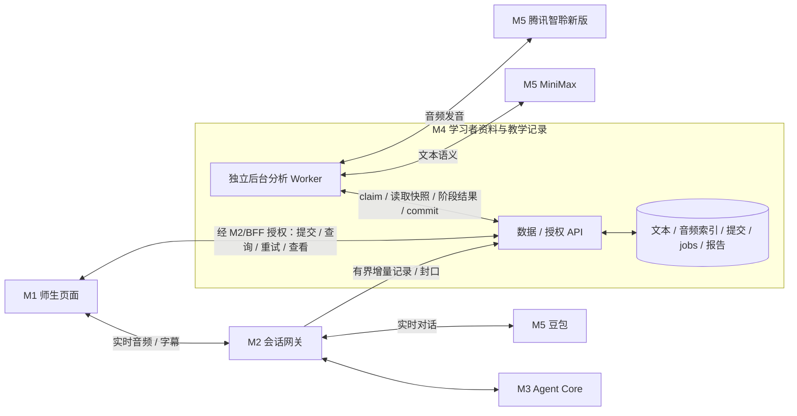

# 对话教学记录与异步报告：M4 技术架构确认

日期：2026-10-27（Asia/Shanghai）。状态：**用户确认架构方向与腾讯选型；阶段 A 本地契约 / 选择策略已实施，全文 / 音频存储、独立 Worker 与腾讯评测待实现或验收。** 关联：[深入报告 Tasking](conversation-report-deep-analysis-tasking.md)、[五个模块](../README.md#32-五个核心工程模块)、[教师助教技术方案](teacher-assistant-technical-design.md)。

## 1. 已确认的架构决策

1. **数据归 M4（学习者资料 / 学习记录模块）。** 一次主题对话的文本、获准学生音频、覆盖与来源、提交版本、分析任务、模型候选和最终报告，均是该学习者本次教学记录的组成部分。它们独立于学习者静态画像；一次模型结论不自动变成长期掌握标签。
2. **报告异步、离线执行。** M2 在对话中有界记录、增量送达 M4；结束时只做有界落盘和封口。沿用当前产品语义：学生明确提交后，由 M4 事务创建待分析任务并返回提交回执。实时语音、结束和提交请求不等待 MiniMax 或腾讯评测。关页 / 告别只结束保存，不自动提交；允许部分报告，但不能假称全部完成。
3. **M4 内设独立分析 Worker。** 逻辑归属 M4，POC 采用独立子进程，与 M4 数据 API / 权限服务和 M2 实时网关隔离。语义与发音是可并行的后台子任务，最后按依赖汇总报告；不是把所有步骤都强行并发。
4. **发音引擎确认采用腾讯云智聆口语评测（新版），必须有接入任务。** `AudioAssessmentPort` 保留可替换边界，当前待实现适配器以腾讯新版为准；是否满足自然对话、逐音节声调等质量要求仍须实测，选型确认不是能力验收通过。
5. **外部能力属于 M5。** M4 Worker 编排调用 M5 的 MiniMax 报告文本模型与腾讯声学评测适配器，接收最小结果并经 M4 校验保存。当前豆包全双工继续承载实时对话，不因腾讯接入切换实时语音供应商。
6. **M1 通过已授权业务 API 获取状态和报告。** 页面可以退出后再次查询；不依赖保持浏览器定时器存活来完成后台分析，不直接访问模型、腾讯密钥、数据库或音频存储路径。

“离线分析”指在对话结束后的后台处理已记录数据，不表示无需网络；调用云模型 / 腾讯服务仍需授权、网络与配额。

## 2. 模块与进程边界

| 模块 | 职责 | 此 feature 的边界 |
| --- | --- | --- |
| M1 Web | 学生 / 教师交互、实时采音播放、状态和报告查看 | 告知与同意、提交 / 查询 / 显式重试、按角色展示文本 / 发音证据 |
| M2 会话网关 | 会话身份、采集归属、实时门控和结束 | 生成可信的记录段与元数据，经授权端口增量写入 M4；不运行报告模型 |
| M3 Agent Core | 当前对话教学策略与动作 | 执行已发布计划；可读 M4 已授权的必要历史，但不能把后台候选直接写成 mastered |
| **M4 数据服务** | 学习者、授权、教学记录、提交、任务状态、报告版本 | 权威校验与持久化、唯一 DB writer、记录 / 任务 / 结果 API、TTL / 删除和投影 |
| **M4 分析 Worker** | 对已提交教学记录执行异步分析 | 领取任务 / 续租，读取固定快照，分支调用 M5，提交候选和报告；无任意 learner 权限 |
| M5 模型 / 语音能力 | 豆包实时语音；MiniMax 文本；腾讯发音评测 | 供应商协议、签名、预算、配置及统一结果适配；不拥有本地学习记录事实来源 |

图中的 M1↔M4 为逻辑业务链路，HTTP 仍经现有 M2 / BFF cookie、Origin 和角色校验；不把 M4 内部端口或 Worker 操作暴露给浏览器。

## 3. 当前实际代码与目标设计的区别

目前 `apps/hskai-mock/src/teacher-assistant/worker.js` 是由 `startHomeworkBackend` 拉起的 **M4 本地 Mock 业务进程入口**，提供内部 `/homework` API，拥有 SQLite。这个文件名包含 worker，但并非已隔离的离线模型分析服务。

当前提交事务已经写入 submission 与 report job，业务进程每 250ms 调用 `service.runReports()`；实际只是同进程的有界确定性规则分析。现有代码没有完整师生文本记录、必要学生原音持久化、独立报告 Worker、MiniMax 报告分析或腾讯评测。当前构造器还会把 running job 重置为 pending；加入外部调用前须按第 7 节改造恢复策略，不能沿用这个行为静默重发可能已计费的请求。

因此不是从零新建另一个画像服务，也不能把现在的轮询改个名字就称为独立分析服务。目标是沿用 M4 的授权与业务事实来源，新增教学记录契约和分析 Worker，再替换有版本的规则分析路径。启动独立 Worker 时**不能再次实例化 `HomeworkService`**：当前构造器会处理 active attempts 和 running jobs，错误复用将影响正在对话的学生。

## 4. POC 部署与持久化决策

- M4 数据服务沿用本地 Mock HSKai 子进程和独立 SQLite 命名空间；身份、授课关系、课程引用和学习记录继续通过授权边界。外部 HSKai 仓库 / 服务、Postgres、Redis 或云队列不是本轮前置。
- 新增独立分析子进程，由同一 POC launcher 启停和监督；逻辑服务可以以后单独部署。Worker 不与数据 API 共享数据库连接、不直接打开或写 SQLite。通过内部受认证的 claim / read / heartbeat / stage-commit / report-commit 接口领取和回传任务，数据服务仍是唯一 writer。
- `jobs / job_attempts / outbox / stage_results`、文本段、manifest、音频索引、报告版本等按切片迁移；复用现有业务 repository。这里是职责与拟议表组，不能当成已经建表。
- 学生音频二进制位于 M4 管理的私有音频存储目录，SQLite 仅保存索引、hash、归属、用途、TTL、质量 / 对齐与授权代次。Worker 只能按任务委托读取必要对象；M1 通过角色校验取得受限音频流，不接收任意文件路径。真实声音与文字、临时文件、签名 URL、密钥不进 Git / 普通日志。
- 外部调用在事务外执行；保存结果使用短事务与来源 / lease / epoch 比较。Worker 服务身份只能执行当前 job 的读写，不能开麦、替人提交、枚举任意学生或更新长期掌握。M4 同时独立处理撤回、删除与 TTL。
- Worker 崩溃或提供方超时不拖垮 M4 数据 API / M2 对话；进程监督支持停止领取、在途取消与有界退出。停止 / 重启 Worker 不会把学生 active attempt 改为 interrupted。

拟议代码职责（路径可在实现时调整，现有文件不会因文档自动移动）：

| 位置 | 职责 |
| --- | --- |
| `apps/hskai-mock/src/teacher-assistant/` | M4 本地数据 API、授权、事务、迁移、claims / leases、教学记录和报告存取 |
| `apps/learning-analysis-worker/src/` | M4 分析 Worker 独立进程与任务编排；不包含浏览器 cookie 或直接 DB writer |
| `packages/teacher-assistant/analysis/` | 任务与快照契约、语义 / 声学候选、校验 / 汇总和双端投影的领域逻辑 |
| `packages/provider-tencent-soe/` | M5 腾讯新版签名、传输、模式与字段映射、错误 / 取消适配 |
| `packages/provider-minimax/` 的独立 report profile | M5 报告文本 transport；预算 / 日志与实时 Planner、AI 备课分别配置 |
| `packages/hskai-bridge/` | M2↔M4 记录 / 业务端口与 M4 Worker 专用最小服务委托；不开放任意内部 RPC |

## 5. 数据归属：单次教学记录与长期画像分开

M4 的 `TeachingRecord` 聚合 learner / assignment / attempt / session、已发布计划快照、学生转写、Kai 实际转发文本、必要学生语音、覆盖 / 对齐 manifest、明确提交、分析版本、证据与师生反馈。记录不可变来源和后续分析修订，不把一次分析覆盖回原始文本 / 音频。

M4 可以将经过审核的分析提炼为未来个性化的学习证据候选，但这是另一个受控步骤：不自动把“模型发现一次声调问题”变成长期标签，不把发音评分直接映射到 HSK 或 mastered。当前 attempted-only 契约与 FreeTalk 内存资料语义不变。

对已发布任务，教师只能看到自己授课关系范围内获准内容；学生只能看到本人记录和允许的反馈。撤回后不返回旧缓存。音频、文本、声学中间结果、报告和任务均纳入 M4 的删除 / 过期策略；不能只删来源而让可识别报告或回听缓存无限保留。

## 6. 结束、提交和异步执行时序

1. 对话期间，M2 的有界记录管道增量向 M4 写入，取得本地接收 / 持久化状态；失败或过载留下实际缺口，不阻塞实时豆包回复。
2. 学生结束：停止采音和播放，M2 只做有界 flush / 封口；M4 固定本次文本 / 音频版本、hash、缺口与权限代次。若仍有无法持久化的部分，如实标记；不等待模型。
3. 学生明确提交：M4 核验本人、尝试、封口和授权，在同一事务写 submission、分析根任务及 outbox；立即回 `submitted + queued`。回执丢失可查同一幂等提交，不能重复建任务。
4. Worker 从 M4 原子领取带 lease 的根 / 子任务；按已固定快照读数据。**语义分支调用 MiniMax，发音分支调用腾讯，资源允许时并行。** 分段、对齐和子任务汇总保留真实依赖，不重复评测已可复用且版本一致的片段。
5. 每阶段结果回 M4，核验来源、当前权限 / 删除代次、job lease、模型 / 数据 / prompt / rubric 版本。语义与声学候选分别校验后才汇总，文本模型只能解释已有声学依据，不能补造发音结论。
6. M4 发布不可变 report version 和对应学生 / 教师投影。M1 查询状态或接收通知后刷新；用户关闭页面不取消已经获准的后台 job。

产品时序选择：当前“结束保存”和“明确提交”仍分开；不因后台分析把关页视为提交。如未来产品希望结束后先作私人预分析，应另定义授权、资源和可见性，不能混用当前提交语义。

## 7. 任务、幂等与故障恢复

- 根任务包含 `learner_id / submission_id / attempt_id / plan_hash / transcript_manifest_hash / audio_manifest_hash / generation / analysis_version / auth_epoch / deletion_epoch / delegation_ref`；不持久化 Cookie、用户 token 或密钥。
- 阶段建议为 `semantic`、`pronunciation`、`aggregate_validate`，每阶段有 pending / running / succeeded / failed / cancelled / unavailable、输入 hash、版本、尝试次数和必要错误类别；提供方调用 ID 仅作受限诊断元数据。报告状态区分 queued / processing / partial / complete / failed / expired / restricted，并附各维度状态。
- `submitted` 是提交事实，不是分析成功。文本先完成但发音排队 / 失败时可提供标明状态的部分反馈；缺少发音引擎不能显示整体已完成。个案音频不合格 / 未授权时明确 unavailable 原因，保持提交回执，整体产品能力仍需 AUD-04 验收。
- Claim、续租、阶段 / 报告 commit 由 M4 原子 CAS 完成；租约过期的旧 Worker 不能覆盖新的尝试。成功已保存的分支按版本复用；重试失败分支或汇总，不无条件重跑所有外呼。
- 外部模型 / 腾讯服务不承诺 exactly-once。调用发出后 Worker 丢失、超时或账单状态不明时保存 interrupted / 调用状态未知，用户显式重试；可安全恢复未发出的排队任务。不得静默无限重发或通过报告版本掩盖重复计费。
- 在读快照前、每次外呼前和提交结果前复核任务委托与 M4 权威授权；撤回 / 删除取消进行中任务并拒绝迟到结果。provider 不配合 abort 也不能写回；保存受限的删除 / 取消元数据而非被删内容。
- Worker 资源池分别限制文本、音频的并发 / token / 音频时长 / 次数；本轮不借改共享 MiniMax transport 预算或将密钥传前端来解决吞吐。

## 8. 腾讯新版接入：已确认选型与必须完成的任务

**选型已确认：腾讯云智聆口语评测（新版），不是将停止迭代的基础版。** 实施任务为深入报告清单中的 **AUD-03-TX01**；AUD-01 现在用于验证这条已选路径的能力边界，不再泛泛停留在供应商候选调研。账户、服务开通、密钥、数据用途与权限未配置前不得伪装调用成功。

官方资料核对（2026-10-27）：新版接口支持 16kHz / 16bit / mono 音频，并提供录音模式 `rec_mode=1` 的单次上限 60s 描述；服务有流式与模式限制，具体组合在接入测试中核实，不能把离线 job 当作任意长度整场音频的一次上传。[新版接口](https://cloud.tencent.com/document/product/1774/107497)

中文自由说不要求预设评测文本；中文句子模式列有音素结果和声调检测。两种模式不能互相推定能力；自然对话整段与局部短句的适用性需实测。[评测模式](https://cloud.tencent.com/document/product/1774/107373)、[中文句子与声调检测](https://cloud.tencent.com/document/product/1774/107396)

AUD-03-TX01 的交付：

- 实现服务器侧腾讯鉴权 / 签名与 `AudioAssessmentPort` 适配器，credentials 仅从 Worker 服务端配置读取。保留 provider / API profile / mode 版本，签名 URL / 密钥不落普通日志。
- 优先验证已存学生片段的录音评测路径，按实测支持的时长 / 字数分段，超限拆段并保留来源区间，禁止直接把超长整场 PCM 塞入请求。若某模式只支持流式传输，在**离线 Worker** 中按官方节奏发送已存片段，不改 M2 实时语音路径。
- 验证中文自由说的准确度 / 流利度与可用定位结果；逐字声调 / 音素反馈采用官方确实支持的模式，核验短句参考内容和对齐，不把可能错误的 ASR 文本当作已确认正确参考，不把自由说总分包装成逐字诊断。
- 归一化仅实际返回且有效的字段（含可空 / 无效的声调结果），绑定音频 hash / 说话人 / 时间范围 / 文本与对齐版本。供应商分数不映射学生等级；能力不足则回 unavailable / review_required，并保留具体范围。
- 有界超时、取消、节流、额度、鉴权 / 服务未开通、空音频、编码错、过长、断开、局部成功、旧结果和已删音频全覆盖。日志只含允许元数据，Worker 不泄露真实学习者材料。
- 分层验收：合成协议 / 适配与故障 → 作者音频真实腾讯 API → 新入口浏览器采集到 M4 离线 job 到报告 → 中文语音专业 holdout；每层报告配置 / 版本、分母、失败与未覆盖。真实接入是完成条件，不能以“适配器已写”代替，也不能把“服务接通”当 AUD-04 的准确性已通过。

拟议配置：`ASK_KAI_PRONUNCIATION_PROVIDER=tencent_soe_v2`、`TENCENT_SOE_APP_ID / TENCENT_SOE_SECRET_ID / TENCENT_SOE_SECRET_KEY` 和独立的报告文本配置。**生产评测配置仍待实现；阶段 A 仅由 `probe:teacher:pronunciation` 预检读取 `TENCENT_SOE_APP_ID` / `TENCENT_SOE_SECRET_ID` / `TENCENT_SOE_SECRET_KEY` 是否存在，不发起调用。** 密钥不写本文件 / Git / 浏览器；不在文档阶段开通、购买、创建账号或外传用户音频。

阶段 A 实际实现与验证见[本地实施](conversation-report-stage-a.md)及[验收记录](eval-results/2026-10-27-report-stage-a.md)。

## 9. 实施任务映射与架构验收

| Task | 交付 | 依赖 / 状态 |
| --- | --- | --- |
| M4-01 | 本文件：教学记录与异步分析的模块 / 进程边界，腾讯选型与实际现状核对 | 本轮设计已确认；运行未改变 |
| M4-02 | 从 M4 数据 API 分离分析 Worker；内部任务委托 / claim / lease / 阶段状态 / commit 与唯一 DB writer | DR-01 / 02；待实现 |
| DR-03 / AUD-02 | M2 生成文本 / 学生音频段，经授权端口写入 M4 教学记录 | 待实现；不落 M2 长期本地档案 |
| DR-04 / DR-05 | 提交事务与 job、Worker 异步分支、版本固定 / 故障恢复 | 依赖 M4-02；待实现 |
| AUD-03-TX01 | 腾讯智聆新版真实接入 / 配置 / 模式适配 / 错误处理 / 离线片段评测 | AUD-01 / 02、M4-02、DR-04；P0 待实现 |
| DR-07 / DR-08 | M4 校验 / 汇总 / 持久报告，M1 经授权查询与回听 | 待实现 |
| DR-09 / AUD-04 | 独立 Worker 故障和负载不影响对话 / 数据 API；真实腾讯、MiniMax及教学质量验收 | 各层分开报告，待执行 |

核心架构验收：Worker 不启动仍可对话 / 保存 / 明确提交并保留 queued；关页后 Worker 可完成报告；Worker 停止 / 重启不关闭学生会话；M4 唯一 DB writer 与权限边界保持；慢腾讯 / 慢文本模型不拖慢 M2；重复领取 / 迟到 / 取消 / 删除不会产生错学生、错提交、错版本或复活的数据。整体 feature 完成仍要求文本、发音两条 P0 路径均通过。
