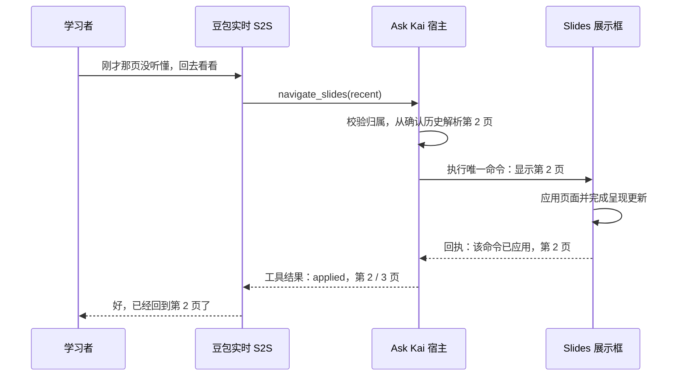

# Ask Kai 对话内控制 Slides PRD v1

日期：2026-10-26 更新。状态：**普通 Agent 已接入，默认关闭；VS-04～06 工程完成，整体验收未通过**。最新接入及分层证据见[第六阶段报告](../eval-results/2026-10-26-voice-slides-control-stage6.md)；此前独立方案见[第四阶段报告](../eval-results/2026-10-26-voice-slides-control-stage4.md)。下文为完整目标需求，未覆盖的验收项仍保留。

本文面向产品、前端、Agent 和语音工程协作。工程边界遵循 [README](../../README.md) 与[现行实施计划](../implementation-plan.md)：独立 FreeTalk POC，业务资料来自本地 mock HSKai，语音保留豆包原生实时全双工 S2S。配套阅读：[技术方案](../voice-slides-control-design.md)、[实施清单](../voice-slides-control-tasking.md)。

## 1. 需求与目标

学习者与 Kai 交流到后面时，可能希望回看先前没听懂的课件。例如，页面当前在第 3 页，学习者说“刚才那页我没听懂，回去再看一下”，Kai 判断回看意图，找到明确的历史目标，切回页面并根据执行结果回应。

首版聚焦**回看已展示内容**，禁用学习者主动“下一页”。正常课件推进属于宿主职责；当前 POC 尚无课件推进引擎，本功能不新增自动推进，也不依据“我懂了／继续吧”自行翻页。演示历史如何建立见 §4.1，迁移时接入目标项目原有课件流程。

**前往后续页的请求仍要识别并接住**。例如当前第 1 页，学习者说“我想看看第 3 页”，Kai 理解为“控制课件进度”中的提前查看请求，回应“一会儿我们会学到那里，先看当前这一页”，保持页面不变。识别到意图不代表必须执行工具，也不能把这种请求当成没有听懂。

本功能要建立一个完整的应用行动闭环：**理解请求 → 调用工具 → 校验并执行 → 确认实际状态 → 口头反馈**。Kai 说“已经翻页”时，页面必须已有对应的执行回执。只生成一句确认语、只修改模型上下文或只刷新一个状态标签，都不算完成。

首版同时验证可迁移的 Agent 页面操作方式。Slides 是第一个具体动作，后续项目可以复用工具契约、执行协调和结果反馈方式，再接各自的页面组件。

## 2. 与口头调速的关系

| 维度 | 已有口头调速 | 本次 Slides 控制设计 |
| --- | --- | --- |
| 产品类型 | 对话中改变应用状态 | 对话中改变应用状态 |
| 意图入口 | 程序对已接受的 ASR final 做保守识别 | 豆包 S2S 模型通过原生 Function Calling 提出动作 |
| 执行对象 | 当前语音会话配置 | 当前浏览器的演示页 |
| 结果依据 | 配置确认、独立控制语音及播放回执 | 浏览器应用目标页后的执行回执 |
| 页面标签 | 展示语速状态 | 展示页码和执行状态 |

两者属于同类产品需求，但现有调速实现不能当成“普通 Agent 已接通 Function Calling”的证据。本功能也不要求把调速改写成工具调用。

### 2.1 独立意图：控制课件进度

本功能定义为独立应用操作意图：**控制课件进度**，内部标识拟为 `courseware_progress_control`。首版的“进度”仅指当前课件展示到哪一页，不是课程完成度、学习掌握度或学习记录。三张 Slides 是该意图的第一个执行载体。

| 层次 | 定义 | 示例 |
| --- | --- | --- |
| 意图 | 控制课件进度 | 学习者希望改变正在展示的课件位置 |
| 处理决策 | 回看执行／提前查看暂缓／目标不明澄清 | 提前查看有语音回应，无页面副作用 |
| 动作 | 上一页／刚才那页／回到指定历史页 | `previous`／`recent`／`goto`，不提供 `next` |
| 参数 | 指定历史页，仅 goto 需要 | `page: 1`，且该页已在本场展示历史中 |
| 执行工具 | 首版 Slides 导航；明确撤销未派发回看 | `navigate_slides`／`cancel_pending_slides` |

**识别触发点在豆包实时 S2S 模型理解学习者语音时**：建连前为模型配置意图说明及工具定义；会话中，模型结合当前对话识别课件操作请求，再按策略区分执行、暂缓和澄清。可执行的回看才发工具调用；前往后续页直接接住请求并说明稍后会学到，不发导航调用。应用接收到调用后，才校验并建立对应操作事务。页面不识别意图，逐轮教学 Planner 也不负责触发翻页。

独立意图是产品及应用控制的分类，不要求另起一个意图识别模型或服务。原生工具调用是可执行回看的可观察入口；没有调用不等于未识别，暂缓请求通过实际回应评测。不假定供应商额外返回名为 `courseware_progress_control` 的事件，也不要求程序先等待 ASR final 并匹配某个关键词才触发模型。

“没听懂”本身是理解反馈，不自动等于翻页；先解释或问“你是想再讲一下这页，还是回到刚才那页？”。“刚才没听懂，回去看看”在目标唯一时触发回看；“回到讲水果的那页”只在历史中有唯一匹配时执行，否则澄清。“下一页”“继续吧”不会触发推进。普通聊天、口头调速与课件控制各有自己的处理职责。一个输入可以兼有交流和操作，不将整段对话强行归为互斥单一意图。

## 3. 首版范围

### 3.1 包含

- 一个固定展示框，三张本地作者编写的演示页，清楚标注“演示内容”；普通新会话初始为第 1 页、无历史回看目标。
- 回看请求：上一页、刚才那页、明确指定的历史页；允许自然表达和已有语言策略下的英文等价请求，不要求学习者知道页码。
- 提前查看请求：下一页、后面的内容、跳到大于当前页的指定页，识别后口头暂缓；不执行、不排队、不设置自动跳转。
- 手动回看上一页／允许回看的已展示页选择，与语音共用同一份会话状态和执行链路；不提供下一页或后续页入口。
- 当前页／总页数、执行中、结果待确认、不可用或断开等必要反馈。
- Kai 在执行后说明成功、边界、拒绝或结果尚未确认；学习者可继续说话和打断。
- 重复调用、连续请求、手动与语音交错、超时和会话结束的处理。

### 3.2 暂不包含

上传或解析 PPT／PDF、动态生成 Slides、多展示框、跨设备同步、真实课程接入、长期保存页码、学习者主动推进到下一页，以及依据页面内容自动授课或视觉理解。首版演示页不作为授权课程、学习成果或能力判断的来源。“当前页是什么内容”的内容问答不是本次验收目标。用固定标题／标签定位历史页，不等于已经具备页面视觉理解或讲解记忆。

## 4. 用户体验

### 4.1 页面

展示框包含演示标识、页标题、简短内容、`第 1 / 3 页` 和手动按钮。沿用现有页面风格，不另建一套对话入口。组件只渲染应用批准的状态，不自行识别语音或解析模型回复。

展示框可在开聊前预览第 1 页；与会话关联的操作在连接和能力协商完成后启用。执行中显示“正在切换…”，避免反复点击。没有更早且已展示的相邻页时，上一页按钮禁用；历史页选择器只列当前及更早且已展示的页，不提供后续页跳转。即使某个后续页曾在本场展示过，回退后也不通过此功能再次向后跳转；当前策略只允许保持或回到更早页。

要演示“到后面再回去”，必须先有展示历史。测试可由可信宿主测试入口依次呈现第 1、2、3 页，取得组件回执后再开始回看用例；该过程不是学习者工具能力。也可使用显式标注的作者预置场景，但预置历史必须标为 synthetic，不声称用户实际看过。首版不为此增加真实课程服务或自动授课引擎。

连接中断后显示“已断开，最后确认第 X 页”，操作禁用。正常结束后保留最后已确认页并标注结束。开始新会话或切换学习者时重置为第 1 页，旧会话不能继续操作新页面。

### 4.2 语音与确认

优先一次自然回应：页面确认完成后，Kai 说“好，已经翻到第 2 页了”。不要求固定播放两段确认音频。

如模型先说“好，我来帮你翻页”，这只是接住请求；取得执行回执之前不能说“已经翻好了”。回应保持简短，沿用当前语言支架和语速，不因翻页请求修改偏好。

| 场景 | 页面行为 | Kai 回应示例 |
| --- | --- | --- |
| 第 3 页说“刚才没听懂，回去看看”，最近历史页为第 2 页 | 确认回到第 2 页 | 好，已经回到第 2 页了。我们再看一下。 |
| 第 2 页请求上一页 | 确认切到第 1 页 | 好，回到第 1 页了。 |
| “回到第 1 页再看看”，该页已展示 | 确认切到第 1 页 | 好，已经回到第 1 页了。 |
| “下一页”／“往后翻一页”，且确有后续内容 | 不改变，识别为提前查看并暂缓 | 一会儿我们会学到那里，先看当前这一页。 |
| 当前第 1 页说“跳到第 3 页”，且第 3 页存在 | 不改变，不调用导航 | 好，你想看第 3 页。一会儿我们会学到那里。 |
| “我没听懂”，没有回看请求 | 留在当前页，解释或澄清 | 我再讲一下这页，还是帮你回到刚才那页？ |
| “刚才那页”，但没有可确认的目标 | 不改变，澄清或说明无历史 | 你想回看哪一页？ |
| 请求更早页但无展示历史 | 不改变，不虚构已经讲过 | 这页还没有展示过，你想让我先解释一下现在的内容吗？ |
| 已在最后一页仍说“下一页” | 不改变，不承诺不存在的内容 | 已经是最后一页了。你想回看前面的哪一部分？ |
| 请求当前这一页 | 保持当前页 | 现在已经是第 2 页了。 |
| 请求第 4 页 | 不改变 | 这里一共三页，你想看哪一页？ |
| “换一下”，目标不清楚 | 等待澄清 | 你想回看刚才那页，还是某一页？ |
| 展示框未就绪 | 不发出翻页命令 | 展示框还没准备好，请稍等一下。 |
| 明确执行失败且未改变 | 保持已确认页 | 这次没能切换，还是第 1 页。 |
| 已发命令但收不到回执 | 标记结果待确认 | 我还没确认翻页结果，先检查一下。 |

示例用于约束含义，不要求模型逐字复述。未知结果时不能断言“仍是第 1 页”，因为页面可能已经切换、只是回执丢失。

“一会儿会学到那里”是对确有后续内容的自然回应，不是已排入的执行任务，不约定时间，也不保证自动跳转。页码不存在时说明实际页数；无法核实目标是否在课件中时先澄清，不凭空承诺会讲到。

## 5. 完整流程

### 5.1 主流程：第 3 页 → 回看第 2 页

1. 页面已通过可信宿主流程依次展示第 1、2、3 页；宿主保存对应回执历史，当前确认页为第 3 页。若用作者预置场景，单独标记其合成来源。
2. 仅在展示框可用、功能开关开启、语音能力经过核验时，为该会话注册仅回看工具能力。
3. 学习者说“刚才那页没听懂，回去再看看”；豆包在原生 S2S 会话中识别回看请求，发出 `navigate_slides({action: 'recent'})`。
4. 宿主核对工具、参数、授权会话及当前操作权限，从确认历史唯一解析目标“第 2 页”。模型不能自行指定浏览器、DOM 或执行代码，也不能凭空创建历史。页面操作独立归属当前会话，不给缺失的供应商输入身份编造话轮编号；语音回复仍核验真实话轮。
5. 宿主向当前展示框发出带动作编号和状态版本的命令，页面显示执行中。
6. 展示框应用第 2 页，完成页面更新后回传匹配的执行回执。
7. 宿主提交已确认状态，并将真实执行结果作为原工具调用的结果返回豆包。
8. Kai 根据结果说“好，已经回到第 2 页了”；后续可继续解释，但不能因切页就声称学习者已听懂。

### 5.2 提前查看：识别后暂缓，不执行

1. 当前已确认第 1 页，课件共三页；学习者说“跳到后面的第 3 页看看”。
2. S2S 模型识别“控制课件进度”意图，判断目标属于当前页之后，选择“暂缓”处理。
3. Kai 直接回应“一会儿我们会学到那里，先看当前这一页”。不调用导航、不派发浏览器命令，不制造执行失败。
4. 页面和 revision 不变，不创建排队请求、待执行目标、提醒或自动推进任务；继续当前交流。
5. 如果模型仍误发 next 或向后续页的 goto，宿主拒绝并返回实际限制；模型据此转为暂缓回应，不能宣称切换成功。

### 5.3 边界、澄清与失败

- **边界或同页**：没有历史可回看或已在目标页，返回已知状态和原因，不伪造页面更新，不自动选择其他页。
- **主动推进被禁用**：识别提前查看意图并回应稍后会学到；工具不提供 next，宿主和前端拒绝向大于当前页的目标跳转，goto 仅允许当前或更早且已展示的页。不能把“下一页”改写为 goto 绕过限制。
- **模糊意图**：先澄清，不把讨论“下一页怎么说”、引用或否定当作实际命令。
- **参数不合法**：宿主拒绝，不自动把第 4 页截成第 3 页。
- **执行明确失败**：仅在确认没有应用时报告失败及原页。
- **执行超时**：先查询同一展示框的实际状态；结果恢复前暂停后续相对回看，不能盲目重发“上一页”。仍无法确认时报告未知并暂停工具能力。
- **没有工具调用**：不通过解析 Kai 的确认语偷偷翻页，也不把程序规则补执行计为原生 FC 成功。真实验证必须记录漏调用和提前宣称成功。

### 5.4 连续请求、打断及取消

第一项确认完成后再次说“上一页”，或明确追加“再往前一页”，属于两个独立请求：在第 1、2、3 页都有确认历史的前提下，从第 3 页依次到第 2、第 1 页。待处理期间重复同一句可能只是催促，不一概当作新增一步；可保持已接受请求并说明当前状态或澄清。同一个工具调用被网络重复传递，只执行一次。手动点击与语音请求按宿主接受顺序串行处理。相对动作 previous 出队时按最新确认页计算；“刚才那页”则绑定本次请求接受时的历史版本与目标，避免排队期间目标漂移。

学习者打断 Kai 的语音，不自动撤销已经接受的翻页。新话轮可以使旧确认语失效，但不能让已发生的页面变化消失。“算了，不要翻了”只取消尚未派发的请求；已经派发的请求先确认结果，不承诺回滚。新请求重新遵守仅回看更早页的策略；若要回到大于当前页的位置，应暂缓回应，不把取消或恢复当成向后跳转的入口。

#### 插话时的具体处理

页面切换作为短事务串行执行；普通插话不要求供应商撤销工具。是否停止旧语音、是否保留页面动作分别决定。

| 学习者后续说法 | 未派发的旧请求 | 已派发的旧动作 | 对话反馈 |
| --- | --- | --- | --- |
| 普通提问：“这个词是什么意思？” | 保留已接受的回看 | 完成并核实实际页 | 旧确认语失效；接住新问题，不补播打断前的确认 |
| 追加：“再往前一页” | 保留，追加新请求 | 先完成旧动作，再算下一次目标 | 两次独立回退累计生效；以最新有效请求的结果回应 |
| 改口：“不是上一页，改成第一页” | 替换被明确纠正的待执行回看 | 先确认旧动作，再执行新的合法目标 | 最后确认实际目标；若新目标已是当前页，不重复切换 |
| 撤销：“算了，不要翻了” | 取消本场尚未派发的回看 | 核实结果，不承诺撤回已发命令 | 没执行才说“没有切换”；已切换则说明当前实际页并停止后续回看 |

“最新请求优先”只用于明确改口，不把两次明确独立的上一页合并。改口／撤销仍须由 S2S 理解并通过受限应用控制通知宿主；新输入开始、语音被打断、普通否定句本身，都不能被程序直接当作“清空翻页队列”。该控制契约已接入普通 Agent；普通 Web 合成场景已验证改口／撤销，真实模型稳定性仍需完整质量回归。

撤销或明确改口后，旧批次未接受的迟到调用也必须失效，不能在后来恢复操作。新操作在配置就绪及新输入边界之后接受；不能自动复活被拒绝的旧请求。页面动作记录当前会话和操作事务，语音／学习话轮仍保留原生归属，工具结果不作为学习证据。

派发中的动作若一直没有明确回执，沿用 2 秒核对、总预算暂定 5 秒的规则：先确认真实页，未知时冻结后续翻页并如实说明。不能拿过期页码继续算下一步，也不等待语音取消 ACK 来决定页面是否已经变化。

会话结束、授权失效或切换学习者后，不再派发动作；旧命令、回执和工具结果不能影响新会话。取消后的供应商调用如何收束，需要真实协议实验通过后才能启用。

2026-10-26 实施更新：明确改口与撤销的受限契约、队列去重及隔离原生实验已补齐；普通插话／追加／改口／撤销七个场景最终观察符合预期，页面执行均为 synthetic。FC 输入归属仍未核验通过，普通 Agent 尚未启用；这不是本节完整端到端验收，见[补验报告](../eval-results/2026-10-26-voice-slides-control-stage2.md)。

第三阶段补充：按确认页收窄原生工具能力，第 1 页没有更早目标时不注册导航；同会话在原工具结果及回复完成后更新能力／指令的三次隔离样本均正确暂缓后续页。还验证了两个独立只读调用的原生批次回传；不代表多项真实 UI 动作或输入归属已验收。具体限制见[最新报告](../eval-results/2026-10-26-voice-slides-control-stage3.md)。

第四阶段采用会话级独立动作及可撤销工具权限，保留原生语音话轮校验，未伪造 FC 输入身份。原 23 条结构回归通过；迟到旧调用、撤销后新请求、改口和明确追加均有隔离样本支持。漏调用及含糊重复仍需质量回归。第四阶段为历史独立实验，见[第四阶段报告](../eval-results/2026-10-26-voice-slides-control-stage4.md)；当前普通页面合成自动化、真实网关插话及人工设备缺口分别见[第六阶段报告](../eval-results/2026-10-26-voice-slides-control-stage6.md)。

## 6. 状态和事实边界

- 宿主保管会话内已确认状态；浏览器负责应用命令及报告执行结果；模型负责提出动作及解释结果。
- “希望翻到第 2 页”“已发送命令”“浏览器确认第 2 页”是三个不同阶段，页面和日志应能区分。
- 浏览器回执证明组件应用了页面更新，不证明人实际看见、听见、理解或学会。
- 手动操作成功后也要同步 Agent 的后续上下文；导航工具每次以宿主最新确认状态执行，不依赖模型记住的旧页码。
- 翻页属于应用操作，不计入语言练习尝试、掌握、正式教学目标或长期画像；若同一句还有实际学习内容，保留有来源的学习部分，不能整轮全部抹掉。

## 7. 验收标准

| 编号 | 条件与预期 |
| --- | --- |
| AC-01 | 三张演示页可展示，页码准确；新会话从第 1 页开始且无旧历史，回看演示有可信展示历史或显式 synthetic 场景。 |
| AC-02 | 上一页、刚才那页、指定历史页的真实语音回看请求触发原生工具调用，页面与反馈一致。 |
| AC-03 | next 在工具、宿主、前端均禁用；任意动作不得跳到大于当前页的位置，即使目标有历史；goto 不访问未展示页；同页不产生多余更新。 |
| AC-04 | 单说没听懂、继续、含糊、引用、否定不误切页；自然回看目标歧义时先澄清。 |
| AC-05 | 同一调用重复只应用一次；有历史时两次独立 previous 累计回退两页；recent 不因排队改变所指目标。 |
| AC-06 | 手动与语音操作共用状态，顺序明确；后续导航不被模型旧页码覆盖。 |
| AC-07 | Kai 不能在匹配的执行回执前宣称翻页已完成；超时不虚报成功或原页未变。 |
| AC-08 | 回执丢失后先核对状态；未确认期间不执行后续相对动作。 |
| AC-09 | 打断和结束隔离旧确认；旧会话不能操作新展示框，已发生的动作如实保留。 |
| AC-10 | 普通聊天保持持续采音和可打断；等待页面回执不阻塞音频上送。 |
| AC-11 | 语速、语言支架、初始／逐轮计划、收尾和学习小结无功能回归，操作不冒充学习证据。 |
| AC-12 | 功能关闭或能力未核验时保持原有语音链路，不向模型声明可操作展示框。 |
| AC-13 | 下一页、后面的内容、后续指定页均被理解为课件控制请求，并在目标确实存在时自然回应稍后会学到；正常路径不调用工具、不派发命令、不排队、不改状态。 |
| AC-14 | 未知目标先澄清，越界或最后一页不承诺不存在的后续内容；误发向后续页跳转的调用被拒绝并转为暂缓反馈。 |
| AC-15 | 普通插话不撤销已接受回看；追加请求累计、明确改口才替换未派发请求、明确撤销不虚报回滚；旧确认音频不抢占新输入的回应。 |

验收分三层：合成合同／replay 检查确定性状态机；真实豆包检查工具触发、归属及反馈顺序；真实浏览器检查页面与播放。三层分别记录分母和失败，连接成功、模拟回执和自动化音频不替代真人设备验收。性能指标及任务见[实施清单](../voice-slides-control-tasking.md)。

## 8. 交付与复用

交付包括展示框、受限导航工具、会话执行协调、结果反馈、最小观测和验收记录。首先验证真实原生协议，再逐步接入，默认关闭，达到验收条件后才允许启用。

迁移到其他 Agent 时，保留“受限工具 → 授权宿主 → 组件执行回执 → 原调用结果”的闭环；替换语音适配器、页面组件和业务授权端口。不要直接复制本 POC 的 mock 身份、课程假设或把演示内容当成真实教学资料。具体接口及模块见[技术方案](../voice-slides-control-design.md)。
