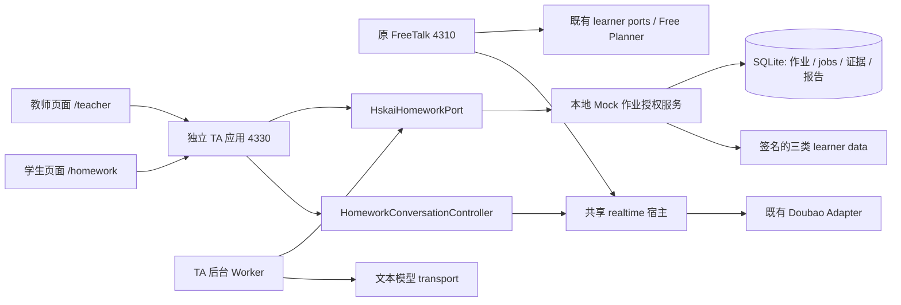

# 教师助教作业主题对话：技术方案 v0.2

日期：2026-10-26（Asia/Shanghai）。状态：完整架构设计保留；最小 Demo 切片已实现，真人设备走查待验。

教师端 AI 前置备课首个子集已实现，实际 v2 契约、单学生任务 / 草案、模型预算、配置及未实现的完整平台能力见[AI 备课实施说明](teacher-assistant-ai-planning-implementation.md)。该子集已按用户要求合并回原 4330 Demo；4331 继续作为独立开发验收入口。

输入：[PRD v0.2](prd/teacher-assigned-conversation-homework-prd-v0.2.md)、[User Journey](teacher-homework-user-journey.md)、[前置规划与原仓库核对](teacher-homework-planning-design.md)。执行顺序及逐项完成条件见[实施计划 / tasking](teacher-assistant-tasking.md)。本文描述完整目标架构；已经实现的最小切片、实际端口 / schema / 配置及与完整设计的差异，以[Demo 实施说明](teacher-assistant-demo-implementation.md)为准；不将未实现的完整平台能力视为已交付。

v0.2 按用户要求改为 **G0 → 最小 Demo → 分角色完善**，完整目标架构保持。当前切片以[最小 Demo 蓝图](teacher-homework-minimal-service-blueprint.md)及[MD-01～MD-08](teacher-assistant-minimal-demo-tasking.md)为准；本文的通用 Worker、AI 生成、多人个性化、语义抽取和评分是后续能力，不要求在 Demo 前全部实现。

## 1. 结论与技术决策

新增独立的 Teacher Assistant 应用，承载“教师定主题 → AI 前置备课 → 教师发布 → 学生按计划主题对话 → 双端反馈”。原 FreeTalk 的入口、默认配置、初始无目标 Planner、逐轮自愿练习及学习记录保持原契约。

| 决策 | 完整目标架构 | 原因 |
| --- | --- | --- |
| 应用入口 | 新增 `apps/teacher-assistant/`，拟议 `npm run poc:teacher`，loopback 默认端口 4330；原 `npm run poc` / 4310 不变 | 新场景独立启动、独立页面，不让新服务成为 FreeTalk 依赖 |
| 业务事实来源 | 新本地 Mock HSKai 授权服务，管理教师、授课关系、作业、证据、提交及报告；应用通过端口访问 | 教师授权不能由前端或 owner 相同推定；不接外部 HSKai |
| 持久化 | Mock 服务独占本地 SQLite；任务、不可变版本、提交、报告及 job/outbox 同库事务 | 支持跨课后时间和重启，避免文件之间部分发布 / 部分提交 |
| 前置准备 | 共享 TopicPack 与私人 HomeworkPlan 分开；后台异步准备，发布前完成 | 学生开聊不生成教学包，学生资料不进入共享资源 |
| 实时复用 | 给现有 realtime 宿主增加默认值不变的注入点；新 HomeworkConversationController 使用同一音频 / 取消 / 字幕基础链路 | 不复制成熟但复杂的实时状态机，也不修改 FreeTalk 目标逻辑 |
| 计划模型 | 作业级 1～3 核心目标、0～1 选做，单轮一个主要任务；核心目标与标准在发布时固定 | 不借用原单目标状态的目标替换来伪装多目标作业 |
| 证据 | 独立全任务账本，区分事件、机会候选、支持候选、语义判断与评级资格 | 旧 attempted-only 小结及前五轮开发记录不够支持作业评价 |
| 反馈与等级 | 学生反馈与教师评价分别生成、存储和投影；自动等级按评估能力门槛启用 | 学生的数据和语音中不出现 A/B/C/D；未知不判 D |

不增加 Redis、云队列、外部数据库、原仓库运行依赖或新的 ASR / TTS 服务。先做一位模拟教师 / 一位成年 Mock 学生 / 一份预置点餐计划的完整闭环，再扩展到四位学生与自动备课。真实语音与教学质量独立验收。

### 1.1 架构完整与切片实现的区别

Demo 先落实身份 / 授课授权、共享资源 / 私人计划、不可变发布、独立会话 / 尝试、证据来源、明确提交和双端报告的职责及契约；只实现这些边界支撑的一条路径，不提前建设所有后台、表和页面。

| 模块 | Demo 当前实现 | 保留的扩展方式 |
| --- | --- | --- |
| 计划生产 | PresetPlanSource 返回作者预置、教师确认的标准计划，source=authored_fixture | AI PlanSource 返回同一 HomeworkPlan；runtime 不依赖计划如何生成 |
| 作业 runtime | 固定角色 / 两项目标与必要控制策略；无外部逐轮 AI Planner 前置要求 | 注入动态 TurnPlanner 与多目标机会调度，不修改 FreeTalk |
| 证据 | 记录实际有效轮次、输出 / 提示范围、必要片段与 unknown | 语义抽取可消费同一证据接口；不把现有未知回填为独立使用 |
| 报告 | 有限点餐观察规则 / 模板按本次事实生成双端反馈，grade=null | 替换 ReportAnalyzer、增加语义 / 评分准入；Submission 不变 |
| 后台 | 只实现持久化报告 job / outbox 的幂等、失败重试和基本恢复 | 后续增加生成 / 按人规划任务种类及 lease / 预算编排 |
| 数据 / UI | 必要 SQLite 表与四个页面；ID / 集合关系通用，当前能力只开放一位接收人 | 增量迁移、多人 / 历史 / 工作台；不按 Maya 姓名硬编码流程 |

`PlanSource.prepare`、`PublishedPlanReader.read`、`HomeworkConversationController`、`EvidenceRecorder`、`ReportAnalyzer.analyze`、`HomeworkPort` 是职责接口，不要求建设通用插件系统。预置实现、模型实现和人工修改均保留来源，不能用同一名称掩盖能力差异。完整字段 / 能力分层可设计清楚，尚未使用的模块和表按需实现。

准备接口允许返回 ready 或 pending；预置来源可直接返回已校验的 ready 计划，未来 AI 来源使用持久任务返回 pending，最终预览 / 发布契约一致。不为预置方案伪造一次 LLM 生成任务或付费调用成功。Demo 只需实际使用的 API 子集与报告 job，不需实现本文所有完整能力 API。

## 2. 当前代码核对与复用边界

本次本地代码核对 HEAD 为 `daba25e394c83d309b073747cc39c5b24965d41b`；已有需求文档为工作区改动，不作为已提交实现。后续实施前重新固定实际基线。

| 已有位置 | 当前行为 / 限制 | 本方案处理 |
| --- | --- | --- |
| [main.js](../apps/realtime-gateway/src/main.js) / [server.js](../apps/realtime-gateway/src/server.js) | 启动 Mock、固定静态路由、learner 授权、准备与 session API | 默认启动及旧路由不加入作业分支；新增应用自行组合 |
| [realtime.js](../apps/realtime-gateway/src/realtime.js) | 直接构造 TeachingSession，固定 WS path / protocol；还直接访问 planning、recap、speech 等协作对象 | 先固定兼容性回归，再增加显式 controller / lifecycle / path 注入点 |
| [TeachingSession](../packages/agent-core/teaching.js)、[Context Compiler](../packages/agent-core/context-snapshot.js) | mode 白名单及既有单主要目标行为，混合 free / sports / mission 路径 | 不把新模式加入这些旧核心流程；新目录独立 controller、state、compiler、validator |
| [ConversationInitializer](../packages/agent-core/conversation-initializer.js) / [Preparations](../apps/realtime-gateway/src/preparations.js) | free 初始无目标；准备一次消费，重新核对资料版本 | 借鉴一次消费与 stale 隔离，新增 HomeworkPreparation；不调用 free 初始化选作业目标 |
| [SessionRuntime](../packages/agent-core/session.js) / [TurnOutputGate](../apps/realtime-gateway/src/output-gate.js) | 回复归属、重复 / 迟到隔离与输出暂存 | 继续复用；作业观察位于校验和输出门之后，target 保持 null |
| [learner-data-port](../packages/hskai-bridge/learner-data-port.js) | 三类签名资料，同 learner 快照一致性校验 | 通过新业务授权后的最小委托读取复用，不把 teacher 伪装成 learner |
| [identity.js](../packages/hskai-bridge/identity.js) | 旧 assertion 必须包含 learner_id，受现有 audience / scope 约束 | 新 teacher / learner actor 契约及 audience；旧校验不放宽 |
| [ConversationStore](../apps/hskai-mock/src/conversation-store.js) | 内存存储，mode 白名单，重启清空 | 不用来保存作业；新持久化命名空间不改变旧数据语义 |
| [MiniMaxJsonTransport](../packages/provider-minimax/planner.js) | 注册的文本 transport，现有 role 的 token / JSON 大小约束 | 新角色 wrapper 复用合法 transport，独立 payload / validator / deadline；不调大 FreeTalk 默认限额 |
| `public/audio.js`、`presentation.js`、`closing-playback.js`、`speech-playback.js`、`voice-readiness.js` | 可复用音频、字幕、播放与就绪组件；`web.js` 绑定旧页面 / API，不能整体复用 | 新页面组合组件；`web.js` / `index.html` 不加载新脚本 |

本机仅做了运行时可加载性检查：Node `v24.18.0` 可导入 `node:sqlite.DatabaseSync`。这不证明仓库最低 Node 22.19 的兼容性、事务或崩溃恢复已通过；最低版本验证列为前置任务。新模块只在新命令中加载，不提高 FreeTalk 的版本要求。

## 3. 应用、业务服务与模块

箭头表示模块调用，两个应用的 realtime 对象、连接表、票据、配置和事件循环分别实例化；不是让 4310 把音频转发到 4330。

### 3.1 运行组合

`poc:teacher` 启动新应用及一个受管理的 Mock 业务子进程。子进程拥有 SQLite，组合四位现有作者画像数据与新作业授权接口；应用和 Worker 只走签名 HTTP 端口。数据库同步 I/O 不在音频网关事件循环运行。模型 Worker 使用有界异步队列，首版无需单独 Worker 部署。

新业务服务内部可复用原 Mock 的资料端口或 fixture 组装函数，但必须先经过新授权边界；不直接把整个 learner-accounts 数据集发给生成器。默认 FreeTalk 后端保持原样，新应用与 FreeTalk 的 Mock 资料修改首版不自动跨进程同步。四人身份同源于 fixture，不声称两个本地进程共享生产学习记录。

子进程崩溃时新应用报告作业服务不可用并关闭其活动任务租约；原 FreeTalk 继续运行。退出时先停止新任务 / 新连接，再取消 Worker、关闭采音 / provider、终止本地业务服务。重启不自动重放未知结果的模型付费请求。

新配置仅由新命令解析，拟议默认如下；不会因仓库已有密钥就静默开始后台付费生成：

| 配置 | 默认 / 规则 |
| --- | --- |
| `ASK_KAI_TA_HOST` / `ASK_KAI_TA_PORT` | `127.0.0.1` / `4330`，只允许 loopback |
| `ASK_KAI_TA_STORE` | `.local/teacher-assistant`，新业务进程独占 |
| `ASK_KAI_TA_TEXT_PROVIDER` | `unconfigured`；显式选择注册 transport 后才允许真实生成，合成演示由专用测试启动配置并标记 |
| `ASK_KAI_TA_VOICE_PROFILE` | 未配置时语音不可开始；显式选择已审核 profile，密钥仍只在服务端本机环境 |
| `ASK_KAI_TA_MODEL_CONCURRENCY` / `ASK_KAI_TA_VOICE_CONCURRENCY` | 各为 1，本机保守起点；上调须记录配额和时延结果 |
| `ASK_KAI_TA_EVIDENCE_RETENTION_DAYS` | 7，仅测试期设计默认；真实试点按授权策略配置 |
| `ASK_KAI_TA_AUTO_GRADE` | false；即使设 true，也必须满足对应 capability / rubric 版本的准入记录，环境变量不能绕过 |

### 3.2 拟议文件职责

| 路径 | 职责 |
| --- | --- |
| `apps/teacher-assistant/src/{main,server,config}.js` | 独立组合、路由、actor 会话、配置及启动 |
| `apps/teacher-assistant/src/{preparations,worker,revocation-channel}.js` | 作业准备、后台任务、撤销 / 租约通知 |
| `apps/teacher-assistant/public/` | 教师页、学生任务页、对话页及学生反馈；不修改旧首页 |
| `apps/hskai-mock/src/teacher-assistant/` | 新本地业务授权、授课关系、SQLite migrations / repository、提交与报告事务 |
| `packages/teacher-assistant/` | brief / pack / plan / report 契约、生成、计划、校验、证据及评级规则 |
| `packages/teacher-assistant/realtime/` | controller、planning state、context compiler 与兼容适配器 |
| `packages/hskai-bridge/homework-port.js` | actor / service 签名调用及大小 / 超时约束 |
| `scripts/teacher-assistant/`、`tests/teacher-assistant/` | 合成 E2E、真实 probe、浏览器检查及新模块回归 |

## 4. FreeTalk 隔离与共享宿主扩展

### 4.1 不变项

原入口 / 页面、旧 HTTP / WS 路径、cookie、Free Planner 输入 / schema / prompt、规则降级、2 秒逐轮预算、偏好 / 小结及 attempted-only 写回均保持原语义。旧 `normalizeEntry`、`TeachingSession`、`compileContextSnapshot` 不接收 `teacher_homework`。

新应用固定 `scenario: teacher_homework`，不以 free / sports / mission 兼容标签运行。不得新增“用旧 mode 存档，再靠附加字段识别作业”的兼容路径。

### 4.2 最小共享改动

`attachRealtime` 增加以下显式选项，旧调用省略时采用原行为：

- `conversationFactory`：旧默认仍创建原 TeachingSession；新应用注入作业 controller。
- `websocketPath` / `websocketProtocol`：旧值 `/api/realtime`、`ask-kai.v1`；新值 `/api/ta/realtime`、`ask-kai-ta.v1`。票据仍一次性、同 origin、同实例。
- `sessionLifecycle`：缺省仍执行现有 open / saveConversation；新应用接作业 session-open / finalization，不向旧 ConversationStore 或 learning-record 写入。
- `authorizeSession`：可选，在票据消费、就绪与有界租约续期复核新场景权限；旧路径仍执行原票据和授权检查，不引入新服务调用。
- `observeTransport`：可选、受限的 accepted-input / forwarded-output / cancellation / playback / terminal 回调，为新场景账本提供实际边界；不改变原事件接受或转发顺序。

目前宿主直接访问 `planning.accepted / executions / speaking / invalidate / observe / consumption / close`、`recap.input`、`speech`、`completedReplyTurns` 等。实施先列出完整调用表，新增作业适配器实现该表；不实例化旧 PlanningState / NaturalTeaching 来获得默认目标。适配器不是把旧状态改造成作业计划。

新组合不向宿主传入旧 learning append / ConversationStore writer；作业生命周期自己注册 session、封口证据和保存作业小结。`save_learning` 不能成为提交作业或写长期掌握的兼容开关，新学生页面不使用它提交。生命周期成功 / 失败 / timeout / revoke / transport-close 都需契约测试，避免只接正常结束路径。

作业侧需实现的主要行为：`contextSnapshot`、`accept`、`planTurn`、`forward`、`completeReply`、`view`、`summarySnapshot`、`finalize`、语言 / 调速 / 拼音控制、取消 / 关闭。旧 `teaching.state` 外包可继续承载学生可见状态；新 payload 必须明确 scenario，不能含教师评级。

共享改动单独提交和验收。先以旧 factory 跑同输入 / 同配置差分，再注入最小测试 controller；没有通过不能继续连接正式作业 runtime。禁止复制整份 realtime.js 到新应用，也不先做无关的全局架构重构。

### 4.3 资源隔离的实际边界

两个应用逻辑 / 本地业务隔离不等于供应商账号配额隔离。新场景独立配置模型角色、调用并发、token / 请求上限及 voice profile，不改全局 FreeTalk 模型或语音 profile。首版前置模型并发 1、语音并发 1，均为保守本机起点。

若演示复用同一供应商账号，要在实测中记录配额竞争；若要求同时使用下的严格资源保证，需要独立供应商配额或共同的配额协调策略。不能凭不同本地端口承诺真实服务永不互相限流。FreeTalk 的零新增业务调用和不被新服务故障阻塞仍为硬验收。

## 5. 身份、授课关系与委托

新 actor 包含 `actor_type: teacher | learner`、`subject_id`、`scope_id`、scopes、`auth_epoch`、过期时间及签名 audience。Teacher 没有伪造的 learner_id。作业 learner 与既有四位 UID 映射由 Mock 服务控制。

新 cookie 拟为 `ask_kai_ta_session`，HttpOnly / SameSite=Strict / Path=/api/ta；与旧 `ask_kai_launch` 不同。同主机不同端口本身不能作为 cookie 身份隔离，应用还校验精确 Origin / Host、audience 和路由。

POC 提供固定模拟 actor 切换入口，明确标 Mock；请求只选择白名单 actor，不能自报角色和任意学生 ID 获权。它是演示登录，不是真实教师认证。创建 voice identity 仅限当前 learner actor，通过原 voice consent / market 校验；教师的授课关系不授予代学生开麦权限。

每次教师读取 / 发布 / 审阅均检查当前授课关系；每次学生操作检查本人分配。服务端不得只检查 scope_id / owner_id。无权对象按统一 not-found 返回，避免 ID 探测泄露。

前置 Worker 使用服务身份与持久化的 `delegation_grant_ref`：引用发起教师、学生、授课关系和授权 epoch，按阶段重新验证。委托仅允许读取当前作业相关的三类最小资料，不允许伪造任意 learner identity、开麦或改学习档案。持久任务不存浏览器 cookie、token 或密钥；浏览器令牌过期不自动延长委托，授权撤销立即使新读取 / 提交无效。

## 6. 持久化模型与事务

数据库位于 ignored `.local/teacher-assistant/homework.sqlite`，目录私有权限。Mock 业务服务是唯一 writer；开启外键、WAL 和有界 busy timeout。任务输入 / 输出 JSON 有 schema_version 与大小约束，不保存原始 provider payload。最低 Node 版本及实际存储选项在 TA-00 / TA-02 验证后冻结。

| 表组 | 核心字段 / 约束 |
| --- | --- |
| actors / teaching_relationships / grants | scope、teacher / learner、active、auth_epoch、授权用途；关系 ID 不可由客户端推定 |
| assignment_drafts / draft_recipients | brief、draft_revision、显式学生名单、截止 UTC + IANA timezone、可编辑状态 |
| topic_pack_versions / material_admissions | 不可变包、可见范围、hash、allowed_fields、来源、失效 epoch；私人材料不进入全局缓存 |
| homework_plan_versions | learner、brief revision、资料摘要引用 / revision、包 / 能力 / prompt / rubric 版本、需要假设及目标、hash |
| assignment_publications / learner_assignments | publication_id、具体 learner 与 plan hash、active 状态；一次发布全体选定对象原子可见 |
| jobs / job_attempts / outbox | job_kind、input_hash、epoch、lease、状态、结果 hash、错误码；幂等键绑定 actor + 操作 + request_id |
| attempts / attempt_sessions / ledger_entries | learner_assignment、plan hash、session generation、状态、事件序号、覆盖统计；最多一条本人的活动尝试租约 |
| evidence_windows / evidence_candidates | 必要上下文片段与引用、事实 / 语义候选分开、support unknown、有效期与处理状态 |
| submissions / current_submissions | 服务端提交序号、尝试、证据快照 hash；当前结果按明确提交事务序号选择 |
| reports / student_feedback / teacher_assessments / reviews | 分离学生输出与教师等级；报告版本 / source hash / 审阅版本不可被后台覆盖 |
| deletion_tombstones / audit | 删除 epoch、最小操作元数据；审计不保留原内容、全文或密钥 |

### 6.1 三个关键事务

**发布：**核对 expected_draft_revision、当前名单 / 授课关系、每人有效计划、资源准入 / 状态 → 在同一事务插入 publication 和分配 → 记录 outbox。任一人失败则整体不发布；教师可明确缩小名单后重新预览发布。更新主题或个人目标产生新 publication，不修改历史版本。

**提交：**核对 learner 与尝试已封口、授权 / 撤回状态 → 幂等创建 submission → 更新 current_submissions → 同事务入 report job / outbox。分析失败不撤销提交。相同幂等键不同请求返回 409；响应丢失可以查询同一提交请求，不靠再次练习补偿。

**撤回 / 删除：**事务内提高对应 epoch、阻止新准备 / 提交 / 结果提交，并写通知 / 清理任务。网关事件通知与租约到期关闭活动会话；UI 在传播未确认时显示处理中，不把数据库 ACK 宣称成浏览器音频已停或真人已处理。

### 6.2 并发与重启

短事务内比较 revision / lease owner / epoch；不在事务中等待模型或网络。Job lease 原子 claim，结果提交使用同一 job、input_hash、draft_revision、auth_epoch、deletion_epoch 与 lease_token 的 CAS。外部模型调用不能声称 exactly-once，服务重启时 running 任务记 interrupted，未知是否已收费的请求需显式重试，不静默重发。

排队但尚未外呼的任务可安全恢复；本地确定性汇总可幂等重跑。报告过期结果只能写自己的历史版本，不更新当前提交指针或教师 review。SQLite 文件锁 / transaction 不等于支持多实例，首版只允许一个业务进程占有该库。

## 7. API 与端口（拟议）

外部页面只访问新应用同源 `/api/ta/*`。下表省略相同前缀；所有写操作做 Origin、actor、schema、大小和幂等 / expected revision 检查。业务服务内部为独立签名 POST audience，不直接接受浏览器请求。

| 方法与路径 | 身份 / 行为 |
| --- | --- |
| `POST /poc/launch`、`GET /runtime` | 明示 Mock actor；runtime 分开声明业务模拟与 voice readiness |
| `GET /teacher/learners` | 当前 teacher 的授权学生摘要 |
| `POST /teacher/drafts`、`PATCH /teacher/drafts/:id` | 创建 / 修改 brief、对象、截止；CAS draft_revision |
| `POST /teacher/drafts/:id/prepare` | 创建幂等前置任务，202 + job_id；不持有 HTTP 等待模型 |
| `GET /teacher/jobs/:id`、`POST /teacher/jobs/:id/cancel` | 进度 / 按人失败 / 取消，无原始模型请求或私有思考 |
| `GET /teacher/drafts/:id/preview`、`PATCH /teacher/drafts/:id/plans/:learner` | 对比及有限结构化修改；修改后重新校验，保留修改来源 |
| `POST /teacher/drafts/:id/publish` | 原子发布；缺少可执行目标不能发布 |
| `GET /teacher/assignments/:id`、`POST /teacher/assignments/:id/revoke`、`PATCH /teacher/assignments/:id/deadline` | 进度、撤回、独立截止策略版本 |
| `GET /learner/assignments`、`GET /learner/assignments/:id` | 仅本人已发布任务卡；无其他 learner 或 teacher-only 字段 |
| `POST /learner/assignments/:id/preparations`、`GET/DELETE /learner/preparations/:id` | 只读发布计划、校验、准备、取消；不生成包或重新选目标 |
| `POST /learner/sessions` | 一次消费准备、建立 attempt/session 租约、返回新 WS ticket |
| `POST /learner/attempts/:id/submit`、`GET /learner/submission-requests/:id` | 明确提交意图；未封口时 202/pending，完成事务后才为 submitted |
| `GET /learner/attempts`、`GET /learner/reports/:id`、`POST /learner/reports/:id/questions` | 本人历史、白名单反馈、反馈疑问 |
| `GET /teacher/reports/:id`、`POST /teacher/reports/:id/reviews` | 教师专属暂评 / 内部备注 / 审阅；expected_report/review_revision |
| `POST /teacher/assignments/:id/follow-up-draft` | 基于证据生成后续草稿，不自动发布 |
| `POST /privacy/erase`、`GET /privacy/requests/:id` | 本人或获准 actor 的删除流程；清理状态与实时终止状态分别返回 |

无效输入 400、身份缺失 401、无权 / 不存在 404、版本 / 幂等冲突 409、配额 429、依赖失败 503。响应不包含 SQLite 错误、provider trace 或其他用户标识。轮询只是观察已存在任务，不能触发新的生成或收费。

## 8. 前置 Planner 与教学包

### 8.1 数据契约

`teacher-brief-v1`：topic_id / label、方向说明、可选课堂要求 / 指定表达 / 材料引用、对象和截止策略。教师自由文本作为数据，不覆盖系统规则。

`homework-topic-pack-v1`：范围、子话题、角色 / 剧情节点、opportunity_templates、可信 skill refs、material refs、admitted_fields、source、scope、版本 / hash / provenance。旧原仓库 pack 只能经适配器复制已准入 context / opening / 能力关联，不能把空 cards / examples 自动补成已审核材料。

`homework-plan-v1`：learner 与 publication 绑定由宿主补；模型只提需要假设、允许的目标 refs、expression_task、core / optional、opportunity_sequence、support_options、delivery_strategy、observation_spec、unknowns 与合法来源。`observation_spec` 引用 capability registry，不生成评估结果或新正式 KP。

每个核心目标有稳定 goal_instance_id、skill_ref、目标语义、是否必须使用指定表达、可接受变体说明、观察标准、先修、材料 / 提示引用、评估能力状态。需区别新情境应用与缺陷补练。同一主题共用需要允许同目标；不固定姓名 / HSK 到目标映射。

### 8.2 任务流程

1. 锁定 brief / 名单 / 关系版本，得到本次 input_hash 与授权委托。
2. 以 topic + 教师范围 + material scope + catalog / admission policy 为键查可复用包；不把学生资料或私有观察放入生成输入。
3. 无合适包时生成、结构校验、指令 / 内容边界检查、辅助内容审阅；每个字段记录准入状态。辅助 LLM 审阅不冒充人工教学认证。
4. 按人读取三类授权资料的一致快照，裁剪到相关能力 / 最近记录；形成需要假设，选择 / 实例化目标并安排机会 / 支持。
5. 校验允许集合、先修、主题相关性、来源、目标数、材料状态和评估边界；具体语义适合性由独立评测校准，不只靠 refs 存在证明。
6. CAS 存草案与按人进度。教师编辑某人支持只重验该计划；修改主题使包与全部相关计划失效；增加学生只生成该生计划。
7. 发布固定包、个人计划、brief、catalog、rubric 和依据摘要的引用；只向当前教师范围公开。

### 8.3 模型与预算

角色为 pack_generator、homework_planner、turn_planner、evidence_extractor、report_analyzer。逻辑职责不等于多 Agent；均通过新角色配置复用文本 transport。不得把新 token / 输出大小全局改进 FreeTalk 默认 transport。

建议实验起点：包生成 60 秒，每人计划 30 秒，根任务四人总 deadline 180 秒；每个阶段至多一次格式修复，共用阶段及根期限。所有模型调用受并发 / 请求 / token 上限控制。实际完成率、耗时和花费单列，预算不是 SLA。

前置生成未配置 / 超时 / 非法时保留草稿失败状态；不静默生成规则计划冒充 AI。明确 synthetic 模式可使用作者包 / 计划演示。允许教师手动补齐草案，但仍经相同资源与来源校验，并记录 teacher_authored。

## 9. 资源内容与新目标准入

复用已有通用能力目录只提供受限交流方向，不等于已具备“点餐数量”“指定句式”的完整教学 / 评分资源。新增 `homework-capability-catalog-v1` 及 material admission，不修改 FreeTalk 的 skill catalog。

首版为点餐、昆虫描述 / 经历、指定句式 / 剧情准备有限的作者能力条目与反例：沟通行为、先修或无硬先修说明、允许情境、指定表达规则、观察 feature refs、支持选项和 assessment_capability。AI 生成主题内容，宿主定义能力边界；不逐主题硬编码四人的最终计划。

菜单 / 例句 / 剧情素材保留 teacher_authored / authored_fixture / llm_generated、作用范围及准入版本。内容可用、语言正确、自动评估可用分别标记。教师可采用材料和任务，但不能通过勾选一个“已审核”就把未校准评估能力变成可靠评分。

“再也不”暂按目标句式实现设计用例，同时保留固定剧情维度；其准确产品含义未确认前，不用该短语创建不可修改的业务类别。

## 10. 学生准备与实时作业状态

### 10.1 准备、票据与权限

HomeworkPreparation 只接受 learner_assignment_id 及当前授权支持偏好，不接收客户端提供的目标或 prompt。读取固定计划、检查发布 / 资源可用、资料变化与 voice consent；初始准备上限 15 秒，包括读取与编译，不做教学包生成或核心目标重选。

准备绑定 learner、assignment / plan / pack hash、profile revision、auth / revoke epoch、执行偏好和有效期。消费时再次核对，并原子取得活动尝试租约；一份准备只消费一次。票据 30 秒、一次性、固定 scenario / Origin / learner / attempt / session generation；WS 握手再检查状态。

资料变化分两类：授权偏好更新影响执行快照；能力 / 课堂要求与计划冲突则返回 PLAN_REVIEW_REQUIRED。未知无法判断冲突时保守阻止该作业准备，保留旧计划供教师重新规划，不影响原 FreeTalk。

### 10.2 状态分离

| 状态 | 内容 / 允许变化 |
| --- | --- |
| PublishedPlan | 核心目标、标准、材料及版本不可变；变更需新发布 |
| TopicScope | 教师主题与允许相关联想；暂停目标保留主题；明确离开可结束任务 |
| GoalRuntime[] | scheduled / active / paused / observed / not_observed；observed 仅表示已有观察，不表示达成 |
| TurnState | 当前输入 / revision、主要动作、一个 active_goal_id、支架建议和待观察方向 |
| ExecutionState | 指令编译 / 发送 / ACK、实际回复、取消、转发与客户端播放声明 |

逐轮从宿主接受有效 final 起共用 2000ms，预留 200ms 提交，包含排队、读取当前可用状态、模型 / 修复及校验。不在该路径额外调用生成器、语义 Judge 或报告器。无活动目标也保留主题范围，尊重拒绝和结束。

模型不能修改核心 goal set、rubric 或发布记录；只能选择合法目标内的下一个机会 / 支持、暂停或建议收尾。规则回退只在同一主题与目标范围内回应，不把英文、沉默或关键词作为失败。主题内选题 / 相关联想 / 完全换题由新契约表达，来源及语义质量分别校验。

### 10.3 上下文与语音

新的 HomeworkContextCompiler 组合现有身份 / 安全基线、授权语言 / 语速 / 拼音、固定作业范围、当前主要任务、必要材料和近期真实前文。没有 teacher-only 等级、评分草稿、其他学生资料或整份历史。任务卡、上下文和会后分析共享同一 plan hash。

初始作业指令在创建语音会话前编译；逐轮沿用 next_turn_advisory，仍可能在本轮语音生成后才更新。ACK 仅证明配置更新，不证明实际使用新计划，执行账本保留差异。新场景不默认开启 controlled、Slides 控制或新的 provider 工具。

### 10.4 撤回与在途隔离

业务服务维护授权 / assignment / resource epoch，向新网关提供受认证的失效通知和短租约。建议起点为每 1 秒续期、最长 5 秒租约；收到撤销立即停止后续任务，连接失败不续期并在租约到期前结束采集。实现须实测传播与缓冲停止时序，不承诺分布式消息瞬间送达。

每次开始、提交、job commit 均核对当前权威状态。通知只是提速，不替代这些检查；撤回提交响应区分“已阻止新操作”和“活动会话已确认终止”。已播放音频无法撤回。安全终止、换人、退出同时清理在途计划、证据窗口、字幕与播放。

## 11. 全任务证据与支持因果

### 11.1 两种覆盖与四类事实

账本覆盖从任务开始到封口的所有有效接受轮次及实际输出元数据，不能只用前五轮。事件已记账与语义已分析是不同覆盖，分别存 `accepted_turn_count`、`durable_event_coverage`、`semantic_reviewed_turns`、`goal_opportunity_coverage` 及缺口原因。

| 事实层 | 来源与可用结论 |
| --- | --- |
| 计划 | 提供了什么目标 / 机会建议；不能证明机会实际出现 |
| 执行观察 | 经过归属 / 安全 / output gate 后的完整转发回复、取消 / 截断和播放声明；转发不等于听到 |
| 学生观察 | 唯一有效 final、来源轮次、实际表达及转写不确定性；不是发音评分 |
| 分析候选 | 目标语义、机会、支持及错误候选，含证据 refs、模型 / prompt / capability 版本；候选校验后才可支撑报告 |

Ledger 观察不使用 raw provider wire 名称推断事实；归一事件与 gateway 实际回调是来源。重复 / 外 session / 旧 generation / 取消后迟到事件不能创建新事实。调速、拼音、结束确认及纯控制语音不作为练习成果。

### 11.2 文本最小化与异步抽取

不把全量逐字稿作为默认持久化方案。网关暂存有界必要上下文，EvidenceExtractor 在音频关键路径之外按小窗口处理，提取与目标有关的最小上下文片段 / 候选及来源；后台通过授权端口持久化。共享包和日志均不接收这些片段。

首版起点：每两个有效学生轮次或一个机会完成后提交抽取窗口；模型并发受统一队列约束。每窗口最多 8 条师生消息 / 8 KiB，按目标最多保留 8 张必要证据卡，总持久化内容每尝试最多 128 KiB；运行上下文最多 2 MiB，均为可调整上限，不是教学轮数要求。记录整个有效轮次的元数据计数，不以保留卡片数替代轮次数。

不能处理或因容量淘汰的窗口标记 semantic_gap；来源截断保留位置和范围。反例 / 更正 / 必要提示上下文不能只为压缩而删掉后仍判独立。实际发生但未能保存的最终轮次标 durable_gap。存在影响核心目标的缺口时反馈说明范围、等级为空，不宣称全场已评。

服务重启后已保存的必要片段与元数据可重试分析；只在内存而未抽取的原文不重建、不伪造。恢复时相应窗口标 source_unavailable。报告失败优先重试现有证据，证据已不可用则成为明确的不足结果，不强迫学生重练来维持“报告成功”统计。

### 11.3 提示、独立使用与音频关联实验

现有输入 final 与回复转发先后不能证明学生开口时是否已听到提示。新增记录 source scope、已转发帮助、client-reported playback、可能重叠与取消，不凭“没有找到提示”推断 none。

TA-10 必须做真实协议 / 普通浏览器小实验，确认可用的输入音频区间、语音开始与 turn 归属、播放时间和取消边界能证明到什么程度；不能从内部字段命名推出供应商支持。若仍不能可靠关联，`support_attribution=unknown`、`independence_assessment=false`，自动等级门槛不放宽。

为来源明确的完整示范后尝试可生成保守描述；具体声调、声母 / 韵母和流利度无独立音频评测时一律未评估。新证据与作业评估不写入旧长期掌握或旧 attempted-only 契约。

## 12. 结束、提交、重练及时间

停止采音与保存 / 提交分开。按钮“结束并提交”立即停止本地采集 / 播放，并发送提交意图；服务收束连接、固定 end_fence（最后有效事件及 source manifest），幂等完成尝试封口后执行提交事务。客户端只有得到 submitted 回执或查询确认才展示已提交。

封口过程中最多有界等待事件写入队列；逾时标缺口，不无限保留麦克风。语义抽取 / 报告可在提交后继续，但只能分析 fence 内已有来源；封口后的迟到 provider 事件不能补入。候选分析版本不改变原始证据快照。

关闭页面、断线和 Kai 告别只结束 / 暂存尝试，不自动创建 submission。网络中断尝试可按 partial 明确提交；报告保留故障限制。首版重连创建新 attempt，旧 partial 尝试保留；不跨 provider session 自动合并（PRD 允许但不要求无损分段恢复）。

再练不清除旧 current submission；新的明确提交按服务端事务序号更新指针，非最高等级。旧报告只落旧 submission。提交时检查授权 / 撤回及尝试 fence，不把未达标当拒交条件。

截止存 UTC 时间和 IANA timezone，页面始终显示当地具体时刻；服务端时间决定迟交，不采用客户端时钟。默认允许迟交且不降语言表现等级；延期独立 deadline_policy_revision，保存原值并重算展示。到截止时不自动切断语音。

## 13. 分析、学生反馈与教师评价

### 13.1 分析分层

ReportAnalyzer 读取发布计划、fence 内的持久证据和覆盖缺口，逐目标生成 opportunity / performance / support 候选及合法 refs。Validator 拒绝虚构引用、跨目标 / 学生拼接、未支持的发音诊断、把计划当执行及缺失当失败；无法确定语义正确的部分保留 unknown / review_required。

学生反馈生成器只接收已接受的事实、建议与未知，不接收 A/B/C/D、数值映射或教师内部评语。教师评估另存 teacher_assessments，可引用同一事实，不将其整体 JSON 发给学生。会话收尾语也不接收教师等级。

### 13.2 评级门槛

建立 capability registry：topic relevance、goal semantics、opportunity validity、support attribution、independence、pronunciation 各有状态与适用范围，绑定模型 / prompt / rubric / 数据版本。结构通过、教师发布和 synthetic 结果均不能开启真实评估能力。

符合 PRD §10 的评级前提后，按固定 A/B/C/D 描述规则确定候选；关键能力未校准、机会不足、转写 / 支持不明或存在关键覆盖缺口时 grade=null。D 还需要所有核心目标的充分有效尝试条件，不能因拒绝、沉默、迟交、断线或 AI 未给机会触发。

最小 Demo 只支持描述反馈，不做教师评级、synthetic 示例等级或完整审阅工作流。后续扩展可增加教师手动评价；真实自动暂评必须完成 TA-20，不能把“有接口”汇报为自动评级已验收。教师手动评价仍记录来源、理由和审阅者，Mock 操作不证明真人教学审核。

### 13.3 审阅、投影与聚合

教师 review append-only，引用 report_version、grade 原值、修改值与理由；公开评语与内部备注分开。重分析产生新 report version，不能覆盖已审阅结果；采用新结果须显式新 review。学生反馈疑问进入该提交的待核对列表。

学生 API / 导出采用固定白名单 DTO，不能删除几个字段后返回 teacher report。缓存键包含 actor、role、learner_assignment、report version、auth epoch；HTTP no-store。错误、通知与学生模型输入均不包含等级；公开评语发布检查显式分数 / 等级内容，需修改的内容不直接发布。

班级按可比 skill / task / rubric 版本汇总，保留 allocated / valid_opportunity / observed / unassessable 分母，不把四人不同目标合成排名。建议来自已观察差距，供教师备课或生成草稿；绝不自动发布下一次作业。

## 14. 留存、删除与可观测性

原始音频默认不持久化；原始 provider trace、密钥、真实逐字稿不入 Git。前置任务只保存必要摘要 / 输入 hash / 来源，不默认保存完整画像和完整模型消息。模型生成思考不收集。

建议测试期最小证据默认保留 7 天、可配置；任务发布与报告生命周期分别记录，读取过期证据时报告显示来源已过期，不能重新赋予完整覆盖。真实试点启用内容存储前明确告知用途与范围，沿用授权的 HSKai 边界。

删除先提高 deletion_epoch、取消任务 / 会话并使读取不可见，再清理片段、报告、评语、jobs 内容、物化聚合与导出缓存。处理 SQLite WAL / SHM / 空闲页和临时文件的 checkpoint / vacuum 与恢复检查；无备份复制的首版本地设计也不能把逻辑删行冒充安全物理擦除证明。

观测只记录相关 ID、hash、版本、阶段、用时、字节 / token 用量、降级 / 失败和来源类别。开发前五轮观测与作业证据不同目录 / 权限；新场景不默认打开旧完整指令观测导出。

## 15. 验收、灰度与回退

核心硬门槛：FreeTalk 行为 / 调用不变；教师 / 学生无越权；学生等级泄漏为零；无过期任务提交；发布 / 提交幂等；缺失不虚构；未验证不评级；旧 attempted-only 不升级。

检查按合成 / 本地契约、真实文本模型、真实 Doubao、浏览器合成设备、真人音频 / 教学分别报告。每次运行 / 合同变化执行 `npm run verify`、`npm run replay`；共享 realtime 改动还要覆盖原浏览器、收尾、调速、拼音以及受影响的 Slides 回归。

当前交付门为 G0 最小架构与旧功能基线 → G-Demo 完整可运行闭环 → 教师 / 学生 / Kai 角色完善 → 完整质量。G-Demo 抽取原 G1～G3 的必要部分，并前移一条真实语音 / 浏览器验收；不等待完整 AI 备课和多人分层。原 G1～G4 保留为完整 TA backlog 的能力验收标号，自动评级仍有独立 G-score。

G-Demo-E 只表示本地业务 / 合成语音链路工程通过，G-Demo-L 另需实际 provider、普通浏览器与设备走查；不能将故事板、预写报告或 synthetic 当作已运行的真实语音 Demo。原完整质量矩阵后续补齐，不能因 Demo 通过重标为全部通过。

新入口独立启动且初期仅 internal / Mock。关闭新应用即可停用新场景，FreeTalk 继续原命令；撤销具体 publication 可停用某份任务。共享宿主 seam 单独可回退，数据库 migration 先备份测试库，避免以回退覆盖已产生的数据；有内容的备份仍遵守留存 / 删除范围。

最小实现已通过 648 项回归、三项回放、Node 22.19.0 新场景测试、独立 / 原 FreeTalk 浏览器检查及一次真实豆包新页面音频闭环。真人听感未验；完整 AI 生成、通用语义 / 支持因果和评级未知项继续保留。见[验收记录](eval-results/2026-10-26-teacher-assistant-demo.md)。
