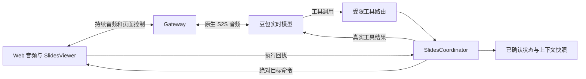
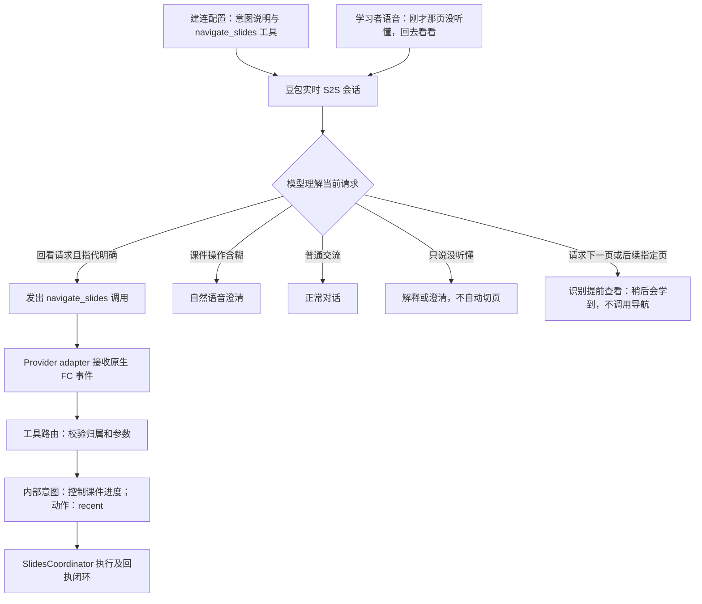

# 对话内 Slides 控制：技术方案

日期：2026-10-25。状态：**设计稿，未实现**。需求见 [PRD](prd/voice-slides-control-prd-v1.md)，执行顺序见[实施清单](voice-slides-control-tasking.md)。本文的新增模块、开关和内部消息均为拟议设计。

## 1. 现状与证据

当前普通路径使用豆包原生全双工 S2S。口头调速由 `speech.js` 识别已接受的 ASR final，交给 `SpeechPaceCoordinator`，不是原生 Function Calling。普通 `seeduplex.js` 校验器拒绝带工具的配置，也拒绝意外收到的工具调用事件；不能直接在页面接一个按钮就视为完成接入。

独立 `fc-planning-probe.js` 已用固定作者输入验证过工具调用／结果回传。在当时三个单输入样本中，工具等待期间未观察到文本／音频，回传后有输出。它没有证明多轮归属、取消、并发、断线，或模型每次一定调用工具。详见[已有协议核验与限制](protocol/seeduplex-planning-control.md)。本轮只有静态设计，没有新真实供应商实验。

采用的协议依据是豆包[全双工 API](https://docs.volcengine.com/docs/DoubaoVoice/endtoend-realtime-voice-full-duplex-version?lang=zh)与[接入必读](https://docs.volcengine.com/docs/DoubaoVoice/access-mustread?lang=zh)，并结合现有独立 probe 的有限证据。实施前需重新核对当前账号／模型的具体协议；不从其他豆包产品或其他厂商 API 借用同名参数。

## 2. 架构决策

### 2.1 保持原生语音，独立工具控制通道



音频路径不经过新的文本生成或 TTS。MiniMax 逐轮 Planner 不承担本次翻页决策，也不要求每轮聊天先调用工具。维持当前 `next_turn_advisory`，不借本功能开启未核验的 controlled generation。

工具调用走独立控制通道，不伪装成普通 `response.*` 音频事件。现有 `SessionRuntime` 对回复／话轮的约束继续保留；工具批次、调用、页面命令和语音回复分别编号。

### 2.2 职责

| 组件 | 职责 |
| --- | --- |
| 豆包模型 | 理解真实页面操作请求、选择工具、获得结果后自然回应 |
| Provider adapter | 注册经过核验的工具，解析 wire 事件、关联调用、回传结果 |
| 工具路由 | 工具白名单、参数校验、会话／输入归属校验、重复调用控制 |
| SlidesCoordinator | 串行执行、页码边界、绝对目标、事务／版本、超时核对 |
| SlidesViewer | 呈现固定内容、执行合法命令、回传组件应用结果、上报手动意图 |
| Context snapshot | 发布已确认页面状态、工具能力及结果反馈约束，保留来源／版本 |

首版只实现导航这一项能力。公共接口保持可迁移，不先建设任意工具市场、DOM 自动化或通用工作流引擎。

### 2.3 意图识别在哪里触发

独立产品意图定义为 **控制课件进度**，内部标识拟为 `courseware_progress_control`。识别范围包含回看与提前查看；处理决策分为 execute／defer／clarify，这些是内部设计分类，不是新供应商事件或工具参数。只有允许执行的回看才使用 `previous`／`recent`／`goto`；next 及任何向大于当前页的跳转禁用。`navigate_slides` 是执行工具，意图、决策和动作不是三个额外模型调用。



这里有两个不同的时间点：**模型理解时识别**，**应用收到原生 FC 时接管执行**。前往后续页属于已识别但暂缓的意图，直接由 S2S 口头接住，不要求额外的“拒绝工具”调用。没有 FC 不能直接计为未识别：暂缓分支要检查回应及无页面副作用。Gateway 不先调用 MiniMax 做意图判断，浏览器也不从字幕／确认语猜动作。收到 FC 不代表执行获准，仍必须通过权限、输入归属和参数校验。

拟议落点：`context-snapshot.js` 编译意图规则和有来源的展示历史，Provider 为会话配置受限工具集；`seeduplex.js` 接收原生调用；`ui-tool-router.js` 校验后规范化为 `{intent: 'courseware_progress_control', action: 'recent'}` 并交给协调器。内部意图标签用于职责、路由和观测，不增加供应商 wire 字段。模型语义识别不以程序先收到 ASR final 为前置条件，但实际执行仍需核验调用与输入的唯一归属；这两个问题分别验证。

首版只把这一意图接到固定 Slides 组件。以后其他项目可保留同一产品意图、换执行工具或组件，不把“课件进度”扩展成任意页面操作。混合输入中的学习内容继续按现有规则处理，单独标记其中的应用操作。

## 3. 工具契约

拟注册一个 `navigate_slides`。以下是工具参数 JSON Schema，不是完整供应商请求：

```json
{
  "type": "object",
  "properties": {
    "action": { "type": "string", "enum": ["previous", "recent", "goto"] },
    "page": { "type": "integer", "minimum": 1, "maximum": 3 }
  },
  "required": ["action"],
  "additionalProperties": false
}
```

宿主额外强制：`goto` 必须带 `page`，其余动作不得带 `page`；拒绝字符串数字、额外字段、未知工具及不合法 JSON。模型不传会话、学习者、目标浏览器、URL、DOM、代码或 deck ID，这些由当前授权会话注入。

工具描述明确：只在学习者确实请求回看当前或更早且已展示的课件时调用；“没听懂”单独出现时解释或澄清，不自动切页；回看指代不明时澄清；引用、否定不执行；下一页／后续指定页识别后用语音暂缓，不能改写成 goto；先读执行结果再宣布完成。描述和参数校验分别负责语义引导与确定性边界，不能把提示词当成服务端保证。

### 3.1 仅回看策略及历史目标解析

限制要在三层同时生效：工具 schema 删除 next；宿主闭合动作白名单拒绝 next／未知动作，所有已解析目标都必须满足 target_page <= confirmed_page；前端没有下一页或大于当前页的入口，手动目标也经过同一回看校验。策略拟为 `navigation_policy: review_only`，不能由模型参数、客户端声明或 Planner 覆盖。

| 动作 | 宿主解析及校验 |
| --- | --- |
| `previous` | 出队时取当前确认页的前一页；必须存在匹配的本场展示历史，不盲目减页跨过未展示内容；没有可回看页则返回未变化及原因。 |
| `recent` | 取请求接受时，当前页之前最近一次确认展示的不同页；绑定 history revision 与绝对目标，不依赖模型猜页码；缺历史或指代不明不执行。若该历史页大于当前确认页，返回向后续页跳转被禁用，不自动换成另一个更早目标。 |
| `goto` | 必须给出合法 page，属于宿主维护的 reviewable_pages，且不大于当前确认页；同页 unchanged，未展示页或大于当前页的目标 rejected。 |

“刚才那页没听懂，回去看看”可用 recent；“回到讲水果的那页”仅在有来源的历史标题／标签唯一命中时用 goto，否则模型先澄清；“这个没听懂”可能仍指当前页，不能硬映射为 previous。自然语言的指代是否明确由模型结合上下文理解，宿主只做确定性历史解析，不声称能用 JSON 校验证明语义理解正确，需专门评测误调用。

**本版禁止任何向大于当前页的学习者跳转**。即使本场曾展示第 3 页、后回到第 1 页，再请求第 3 页也不执行，而是暂缓回应。未来正常课件推进属于独立宿主流程，不通过回看工具恢复或自动推进。

schema、动作白名单与目标比较可硬拒绝 next／未展示目标／大于当前页的目标；仍不能仅靠合法 goto 参数证明用户确有回看意图，自然语言误判需单独评测。

### 3.2 提前查看的暂缓回应

在完整上下文中明确写入：当前确认页、总页数、可核验的后续页元数据、仅回看策略以及提前查看的反馈规则。模型理解“下一页”“想看看后面的内容”“到第 3 页”后，若目标在当前页之后且确实存在，直接回应“一会儿我们会学到那里，先看当前这一页”。不调用 navigate_slides，不发浏览器命令，不创建 action transaction、排队目标、定时任务或自动跳转承诺。

目标不明先澄清；页码越界或已经最后一页时说明实际限制，不承诺不存在的后续内容。“稍后会学到”依据真实课件内容和宿主流程表达；纯演示只证明请求理解及反馈，不代表已接入真实课程推进。

若模型仍误调用 next 或 goto 到大于当前确认页的位置，宿主在派发前返回 `status: rejected`、`reason: FORWARD_NAVIGATION_DISABLED`，携带当前确认页和总页数；不提交 revision、不改变历史，模型按结果转为暂缓回应。非法页码优先返回页码无效，不拿统一暂缓话术掩盖不存在的页。提示词负责正常分支，宿主校验负责阻止误调用产生页面副作用。

目标策略必须在请求接受和出队派发前都检查。比如排队的 goto 2 原本在第 3 页时可执行，但前一个回看已将页面切到第 1 页，此时 goto 2 就需拒绝，不能以旧时可执行绕过当前限制。

结果为结构化、有限字段：

```json
{
  "status": "applied",
  "action_id": "host-generated-id",
  "reason": "PAGE_CHANGED",
  "page": 2,
  "total": 3,
  "revision": 1,
  "confirmed": true
}
```

| status | 含义 | 允许说什么 |
| --- | --- | --- |
| `applied` | 匹配回执确认目标页已应用 | 已经切到第 X 页 |
| `unchanged` | 无可回看历史或已在目标页，已知状态未变化 | 还没有可回看的上一页／当前就是第 X 页 |
| `rejected` | 参数、能力、当前会话或后续页策略不允许 | 后续页请求转为暂缓；非法目标说明实际限制，不称已执行 |
| `failed` | 可以确认执行未应用 | 没能切换；仅已知时说明原页 |
| `unknown` | 已派发，执行结果尚未确认 | 还不能确认；`page`／`revision` 置空，不能当成未变化 |
| `cancelled` | 未派发即撤销，或经确认没有应用 | 请求已取消，不虚构回滚 |

`page` 是 1 起始。工具结果不含身份、原始转录或完整学习资料。确认的是组件应用结果，不是人眼观看证据。

## 4. 原生 Provider 接入及准入实验

既有独立 probe 的 wire 形状是：会话注册直接 `name`／`parameters` 的工具；接收 `response.function_call_arguments.done` 的 `items`；通过 `conversation.item.create` 的 `items` 返回匹配 `call_id`、`role: tool` 和 `input_text`。实施应依据重新核验的原生协议封装，不把下文内部 `slides.*` 消息发给豆包。

普通 adapter 改为**显式能力配置下的有限允许**：默认仍拒绝工具；仅 reviewed 的 Slides 工具集允许进入。不能简单删除 `UNREVIEWED_SEEDUPLEX_FEATURE`／`UNEXPECTED_PROVIDER_TOOL` 防线或沿用旧 reviewed 标记冒充新能力已批准。

Provider 需要提供受限工具注册、规范化调用通知、批次结果回传和终止／清理接口。`packages/contracts/provider.d.ts` 目前注明 proposed 且并非现行 wire 实现，须与真实使用的 JS 接口一起对齐，不能仅改类型声明。

实施前必须核验：

1. **归属**：工具到达可能早于 ASR final。区分 `call_id`、question、turn、response；只使用核验后的关联字段或明确独占的输入生命周期。无法唯一关联时不执行，禁止退回“绑定最近一轮”。
2. **输出顺序**：实际页面工具等待时是否有文本／音频、是否提前宣称成功；提示词不能证明零提前成功。已有 `TurnOutputGate` 是否足以接住相关输出需实验。若缺少可靠控制而出现虚报，保持默认关闭，不承诺靠语义过滤音频解决。
3. **持续输入**：等待工具结果期间继续按已核验方式上送音频，覆盖新输入和打断；不能通过断流强迫模型等待。
4. **批次**：首版一次批次只接受一个导航调用；多个调用不产生部分页面副作用，按核验后的聚合结果协议返回限制。不猜测 `tool_choice` 或 `parallel_tool_calls` 配置。
5. **取消**：新话轮、显式取消、断线后，工具批次怎样进入终态、能否安全回传取消结果、会不会引发旧回复。不能仅因页面事务完成就回传过期调用。

同一会话同一 `call_id` 且参数一致：复用同一执行事务及结果；不得再次应用页面。参数冲突是协议错误。尚未终结的重复调用挂接原事务，不额外发送多次工具结果。归属不明的非法批次不能随意猜造 wire 结果，走已核验的失败／关闭路径。

不要求服务端强制每轮 FC；但真实明确导航请求必须计入触发评测。漏调用或误调用都是缺陷，不能用 regex 执行兜底后算原生成功。

## 5. 状态、执行与一致性

### 5.1 状态归属

宿主持有：`session_id`、连接代次、`viewer_instance_id`、固定 `deck_id/deck_version`、`confirmed_page`、`revision`、可用性和最多一个在途动作。请求、希望到达的页与已确认页分开保存。

新增有界 `confirmed_visits`、`reviewable_pages` 及 `history_revision`：只从当前授权会话中匹配的组件回执记录页、标题／标签、顺序和来源；初始状态完成回执后也记入当前页。最多保留最近 20 次访问，本次三页的展示集合另行保留到会话结束。实时可执行目标 `allowed_review_pages` 为展示集合中不大于当前页的页，历史存在不代表当前允许跳转。已发送但未确认的目标不进入历史。模型不能声明“第 2 页看过了”来添加集合，历史也不作为看懂／学会证据。

当前 POC 没有独立课件推进引擎，普通新会话在第 1 页且不开放 next 时，本来就没有历史可回看。为验证真实回看链路，专属测试入口可通过可信宿主测试端依次应用三页并记录回执，然后开始学习者请求；不暴露为普通页面按钮或模型工具。预置场景则必须明确标记 synthetic_history，不能混入真实组件展示分母。未来迁移由项目原有授权课件流程提供当前页和历史，本次不实现课程引擎，不改变 M4 mock 边界。

deck 使用一份固定版本 manifest，建议置于 `public/slides/demo-deck.json`：三页作者演示内容，固定本地资源；网关启动时校验，浏览器加载同一版本。作为公开演示资产服务，不夹带真实课程或身份数据；静态路由显式允许，不开放任意目录读取。组件用安全文本／白名单资源渲染，不执行模型 HTML。

### 5.2 一次导航事务

`received → validated → queued → dispatched → applied / failed / unknown`。未派发可进入 `cancelled`；边界与同页在校验后直接 `unchanged`。

1. 路由创建唯一动作，校验绑定当前会话与工具输入归属。
2. 单展示框串行；最多一个在途、两个排队动作。排队有效期暂定 5 秒，过期返回忙／未执行，不重用旧意图。
3. previous 出队时用最新已确认页计算目标；recent 使用接收请求时绑定的历史目标，goto 使用明确指定目标；都重新校验当前 deck、回看策略与历史有效性。每次新动作携带唯一 `command_id`、基准 revision 和目标 revision，向浏览器发送**绝对页码**。
4. 浏览器核对会话／连接代次／viewer／deck 版本及基准 revision；相同命令幂等，冲突命令拒绝。应用目标页、完成 DOM 更新／绘制机会后回执。
5. 宿主只接受匹配事务、目标和版本的回执，提交新 revision，并向仍有效的原调用返回结果。

DOM 更新／绘制机会不保证屏幕实际可见；后台标签页可能延迟回执，应进入待确认而非假定成功。边界和同页不增加 revision；每次真实页面改变增加一次。

### 5.3 手动操作

手动按钮发送意图，由同一宿主协调器派发命令；浏览器不先自增再通知服务端。手动意图带自己的去重编号，入同一队列。按钮执行中禁用是体验优化，服务端仍负责串行和重复保护。

前端只提供上一页和 allowed_review_pages 选择器，不提供下一页或大于当前页的跳转。客户端伪造 next、未展示页或大于当前页的 goto 时，宿主仍拒绝；不能把隐藏按钮当成权限校验。

成功后更新后续上下文；手动点击没有对应模型 `call_id`，不得伪造工具结果。工具的相对导航永远使用宿主状态，模型快照稍晚更新也不能覆盖当前页。首版不承诺模型在快照尚未确认时回答任意实时页面问答。

### 5.4 超时与失联

拟议默认：页面回执等待 2 秒，单工具事务含核对总预算 5 秒；这是待实验调整的宿主预算，不是供应商时延保证。

- 超时后冻结相对导航；在同一有序 WebSocket 上发出状态核对屏障，浏览器处理此前命令后返回该连接代次的实际页码／revision／命令状态。
- 屏障回执前不恢复队列，防止“查询说未执行，旧命令随后才应用”。必要重发只能用同一个绝对命令及编号，不能重新计算上一页。
- 有确切应用证据则提交；明确未应用才报告失败；无法确认则结果为 unknown，暂停工具并显示待恢复状态。
- 迟到回执只能收束同一尚待核对的事务；不能唤醒过期语音。断线后不把旧相对请求自动迁入新会话。
- 重连首版采用新会话重置，不做跨连接事务恢复。结束／换人后 viewer 更换代次，拒绝旧命令。

### 5.5 取消与两种生命周期

**页面动作生命周期**和**语音回复生命周期**分开管理。新的“再往前一页”可以打断旧确认音频，但不会自动丢掉前一个已接受动作。两个独立 previous 请求在同一队列执行；recent 的指代则绑定原历史，不在队列中重新解释。

显式撤销只移除未派发请求；派发后核对真实结果，再决定如何反馈，不能标成“没执行”。同一工具结果只在原调用仍可合法收束时回传。若模型原调用已失效，保留实际页面事实、隔离旧确认，按核验后的取消协议终结批次；没有安全终结方式时暂停工具／终止该语音会话，不能向新轮回填旧结果。

结束、安全限制或授权失效停止派发并清理队列，继续遵守现有 response／turn 所有权与迟到事件隔离。

## 6. 启动、上下文与其他控制的协作

拟新增 `ASK_KAI_SLIDES_CONTROL=1`，默认关闭。开启条件同时包含：开关、经核验的工具 profile、当前授权会话、固定 manifest 可用、当前 viewer 就绪。任一不满足，不声明可操作 Slides。

建议启动顺序：页面获取能力并加载 viewer → 建立现有授权连接 → 有界 `slides.ready` 握手绑定 viewer 与 manifest → 宿主构造工具集并打开 provider → provider 真实 ready 后继续现有麦克风流程。握手超时按未启用工具打开普通语音，不能因没有 Slides 让原有聊天不可用。viewer 声明只是组件可用输入，不是授权证据；会话权限来自现有票据。

拟新增内部消息：`slides.ready`、`slides.intent`、`slides.command`、`slides.ack`、`slides.sync`、`slides.snapshot`、`slides.state`。每种闭合 schema、明确方向及长度限制；入站继续遵守现有 1024 字节控制消息和速率限制。manifest 不塞进入站控制包。它们是 Web／宿主内部消息，**不是豆包 wire 事件名称**。

完整 Context snapshot 增加有来源的 `ui_capabilities` 和已确认 `slides_state`，包含版本、是否可用、review_only 策略、allowed_review_pages、有限最近历史及提前查看暂缓规则；未确认目标不冒充当前页。初始／逐轮计划、语速变更和收尾重编译都必须保留该状态。页面回看只改变展示位置，不自动推进教学阶段或产生课程进度记录。

页面操作结果是本次确认的直接依据，不等待逐轮 Planner。工具结果回传不得卡在“等 response.done 才更新上下文”的队列后面，否则模型等工具、宿主等模型结束会死锁。实际 wire 写入统一排序，但结果回传与配置 ACK 等待不能互相依赖；冲突的指令／语速／收尾事务要显式排队或取消，而音频持续上送。

应用操作元数据进入独立观察类别。`TeachingSession` 对纯 UI 控制不生成学习尝试、目标或教学总结证据；混合输入保留真实交流／练习内容并标明来源。不能简单把工具结果当成普通 assistant 教学回复送入现有观测链。

## 7. 核心模块及文件变化

以下是实施预计范围，不表示本轮已修改这些文件。

| 核心模块 | 拟修改／新增位置 | 具体改变 |
| --- | --- | --- |
| M1 Web | `public/index.html`、`public/web.css`、`public/web.js` | 增加展示区、能力与就绪握手、消息分发、手动操作和状态提示 |
| M1 Web | 新 `public/slides-viewer.js`、`public/slides/demo-deck.json` | 被动组件、固定三页、幂等命令和执行回执 |
| M2 Gateway | `src/server.js`、`src/main.js` | 静态资源白名单、开关／能力配置、启动参数 |
| M2 Gateway | `src/realtime.js` | 工具控制通道、viewer 绑定、回执分发、收尾／授权清理、与现有控制协调 |
| M2 Gateway | 新 `src/slides-coordinator.js`、`src/ui-tool-router.js` | 有界动作队列、状态事务、校验、去重、超时核对和结果路由 |
| M3 Agent Core | `packages/agent-core/context-snapshot.js` | 编译已确认 UI 状态及工具反馈约束，保留快照来源 |
| M3 Agent Core | `packages/agent-core/teaching.js`，按需 `session.js`／观测小结相关模块 | 分离应用控制与学习证据；审查输入／回复生命周期，不削弱既有所有权约束 |
| M4 Learner data | 无计划内改动 | 演示数据独立，不新增真实 HSKai／课程接口或长期画像写入 |
| M5 Provider | `packages/provider-doubao/seeduplex.js` | 显式允许核验工具集、FC 事件及批次结果、归属／取消适配，保持音频 lane 规则 |
| 公共契约 | 新 `packages/contracts/ui-actions.js`，对齐 `provider.d.ts` | 有界内部工具／页面消息、状态及结果契约；不猜供应商事件 |
| 观测 | `src/observation-reports.js`、`packages/agent-core/observation-summary.js` 等按需 | 动作元数据和耗时／失败原因，区分已请求／已派发／已确认 |
| 验证 | `tests/`；新 `scripts/voice-slides-control/` | 合同、状态机、原生 probe 和浏览器检查分层，实验工具集中存放 |

上表 `public/` 与 `src/` 均相对 `apps/realtime-gateway/`。普通入口使用 `web.css`；现有 `presentation.js` 负责音频／字幕呈现，不能因同名概念改作 SlidesViewer。现有调速识别器及 MiniMax Planner 不作导航执行器；若接口协作需要改动，先补充具体范围。

## 8. 观测、验证与迁移

只记录有界元数据：会话内匿名关联、调用／动作编号、动作类型、前后页及 revision、派发／回执／结果时间、失败原因、归属和 synthetic 标记。不新增原始 provider trace、真实学习者音频／转录或密钥入库。已有授权观测导出的隐私边界不扩张。

验收必须能追溯：请求 → 原生调用 → 校验 → 命令 → 回执 → 工具结果 → 对应回复；“收到工具”不等于“页面已变”，“收到音频”不等于“实际播放”。完整测试矩阵和阶段门槛见[实施清单](voice-slides-control-tasking.md)。

迁移时建议保留三个小接口：`ToolRouter.accept(call, ownership)`、`SlidesCoordinator.execute(intent, session)`、`ViewerPort.apply/query(command)`，名称仅示意。ProviderPort 替换各项目语音 wire；ViewerPort 替换 React／原生 Web 等组件；AuthorizationPort 使用各项目自己的会话边界。页面状态内存只属于当前会话，不复制 mock 身份、Planner 实现或本 POC 的供应商保证假设。

关键风险仍是**原生工具输入归属、工具等待前的输出、取消后的批次终结**。先做针对性实验；验证失败应报告具体缺口并保留默认关闭，不擅自改成文本分段合成或规则识别执行。
